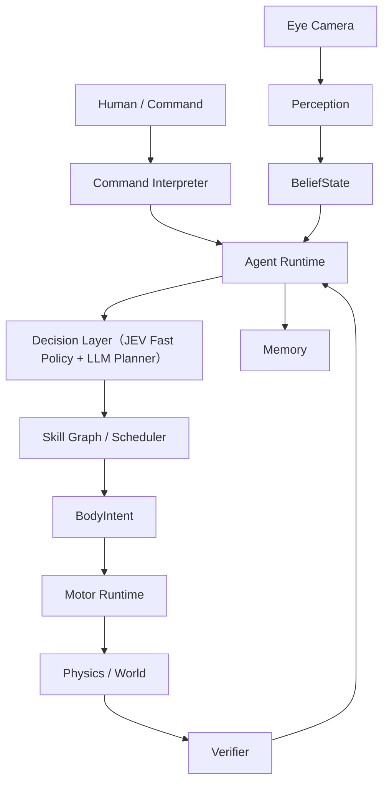

# 00｜总体架构：具身智能角色运行时

> 本文是 `理论框架` 的总纲，定义系统的定位、原则、分层、频率域与技术基线。
> 本目录只描述**一套架构**，不再保留 v1 / v2 / v3 之类并行版本；历史版本的差异已经在这里合并成唯一结论。

---

## 1. 系统定位

本系统**不是**"把 LLM 接上 Unity 角色"的对话机器人，而是一个**具身智能运行时（Embodied Agent Runtime）**。

设计目标：

- 感知真实世界（相机是传感器，不是"视觉"本身）；
- 维护主观信念（`BeliefState`），允许出错、允许不确定、随时间衰减；
- 基于状态做决策，而不是每帧调用一次 LLM；
- 调度**可验证**的行为单元（Skill）；
- 驱动身体执行（RigGraph 控制骨架与 IK，物理负责接触与平衡）；
- 从结果中学习（遥测 → 经验 → 策略）。

主循环：

```text
Observe → Belief Update → Decision → Skill → Motor → World → Verify → Memory
```

一句话概括技术取舍：**LLM 不再是"大脑本身"，而是运行时里一个可替换的慢速推理模块。**

---

## 2. 第一性原则（所有设计的裁判）

1. **Camera ≠ 视觉。** 相机只产生像素；视觉系统才产生"对象、位置、置信度"。
2. **视觉 ≠ 理解。** 检测框不等于"我知道那是什么、它要干什么"。
3. **理解 ≠ 事实。** 理解是带置信度的假设，写进 Belief，允许错。
4. **Perception 是"这一帧看见了什么"，Belief 是"我认为世界是什么样"。** 两者必须是两个数据结构、两次写入。
5. **Brain 不直接控制骨骼。** 上层只说 `LookAt(cup)` / `Reach(RIGHT_HAND, cup)`，关节角与插值属于 Motor。
6. **Agent 不直接读取 World Truth。** 角色依据 Belief 行动，系统依据 World Truth 验证；只有 Verifier 与 Debug 面板可以碰真值。
7. **LLM 不承担实时控制。** 不参与 50 Hz 控制、IK、物理判断、精确计时，也不自己宣布"成功"。
8. **Skill 是可验证行为语言。** 每个 Skill 有输入、前置条件、状态、超时、失败码、可验证的完成条件。
9. **一切跨进程消息结构化并带 `schema_version`**，未知字段忽略而不是报错。
10. **新鲜度 > 完整性。** 队列满时丢最旧帧，保留最新帧；永远让 Unity 主线程跑在最新有效意图上。

---

## 3. 分层架构



### 3.1 层职责

| 层 | 位置 | 职责 | 明确不负责 |
| --- | --- | --- | --- |
| 感知 Perception | Unity + Python | 取帧、检测、跟踪、深度→三维、场景语义 | 决定下一步做什么 |
| 信念 Belief | Unity（阶段一）→ Python Runtime（阶段三可平移） | 主观世界模型、匹配、衰减、事件 | 读取真值、控制身体 |
| 运行时 Runtime | Python | 事件循环、状态图、目标仲裁 | 50 Hz 控制、IK |
| 决策 Decision | Python | 快决策（typed decision）+ LLM 慢推理 | 关节角、物理 |
| 技能 Skill | Unity（执行）+ Python（编排） | 启动、Tick、取消、验证、失败码 | 骨骼细节 |
| 运动 Motor | Unity（RigGraph） | IK、注视、步态、平衡、手部 | 长任务规划、记忆 |
| 真值 WorldTruth | Unity | 物理、碰撞、验证、Debug | 作为角色认知输入 |

### 3.2 频率域（必须显式区分）

| 域 | 频率 | 说明 |
| --- | --- | --- |
| 渲染 | 60 FPS | 与取帧解耦 |
| 物理 / 刚体 | 50 Hz（`FixedUpdate`） | Rigidbody、关节 |
| 运动求解（IK Target 平滑 / 步态 / 平衡） | 30～60 Hz | 留在 Unity |
| 视觉采集 | 8～10 Hz | 可降级到 5 Hz |
| 快理解 Fast Vision | 5～15 Hz | 有状态、顺序消费 |
| 信念更新 | 10 Hz + 事件 | 匹配、衰减、发事件 |
| 身体状态汇总 BodyState | 10～20 Hz | 语义状态，不是骨骼四元数 |
| 决策层 | 事件触发 | 不轮询 LLM |
| 仔细理解 Slow Vision | 事件触发（秒级） | 超时即放弃，不阻塞快路径 |

---

## 4. 技术基线：团结引擎 1.10

本项目的运行基线是**团结引擎（Tuanjie Engine）1.10**，其编辑器内核为 Unity 2022.3 LTS 分支。

| 项 | 取值 | 说明 |
| --- | --- | --- |
| 编辑器 | 团结引擎 1.10.0（`m_EditorVersion: 2022.3.62t12`） | API 与 Unity 2022.3 LTS 对齐；不要使用 Unity 6 专有 API |
| 渲染 | URP `com.unity.render-pipelines.universal` 14.2.0-t1 | 对应 Unity 2022.3；**没有** Render Graph（URP 17 才有） |
| 角色动画 | **团结 Rig Graph** `cn.tuanjie.riggraph` 1.0.0 | 取代 Animation Rigging；节点图 + Control Rig + Effector |
| 可视化脚本 | `com.unity.visualscripting` 1.9.5 | RigGraph 的节点图运行时依赖 |
| 学习 | **ML-Agents 2** `com.unity.ml-agents` 2.0.2 | 推理后端为 `com.unity.barracuda` 3.0.0；训练用 Python `mlagents` |
| 导航 | `com.unity.modules.ai`（NavMesh / NavMeshAgent） | 未安装 AI Navigation 包；阶段二起按需决定是否加装 |
| 编辑器桥 | `cn.tuanjie.codely.bridge` 1.0.81 | 编辑器侧工具链，不参与运行时链路 |
| 外部服务 | Python 3.x + FastAPI + OpenCV + Ultralytics | 视觉理解服务，跨进程、可降级 |

### 4.1 从旧技术栈迁移的两条硬性约定

**（1）动画控制：Animation Rigging → 团结 Rig Graph。**

本项目**不使用** `com.unity.animation.rigging`。所有 IK、注视、手部、骨骼约束统一在 RigGraph 内实现：

- 不再有 `RigBuilder` / `Rig` / `BoneRenderer` 组件，改为 `RigGraphManager` + `RigGraphAsset`（Control Rig 图）+ `RigGraphScriptMachine`；
- 不再有 `TwoBoneIKConstraint` 之类的 MonoBehaviour，改为图中的 `Two Bone IK - Simplified`、`Two Bone IK`、`Chain IK Constraint`、`Full Body IK`、`Aim Math` 等节点；
- 运行时驱动不再"移动 Target 物体的 Transform"，改为驱动 **Effector**（`RigEffector.SetPositionOffset / OffsetRotation` + `LockState`）或设置 **Rig Graph Variables**。

细节见 `05_运动系统_RigGraph与全身控制.md`。

**（2）学习与推理：ML-Agents 2。**

`com.unity.ml-agents` 2.0.2 即 ML-Agents Toolkit 2.x：训练在 Python 侧（`mlagents-learn` + YAML 配置），模型以 `.onnx` 资源导入，通过 Barracuda 在端上做推理；不涉及旧版 `Brain` 资产。细节见 `06_学习与训练_MLAgents2.md`。

---

## 5. 架构思想的吸收方式

本架构不是原创于真空，它明确吸收三条工程传统：

| 来源思想 | 吸收了什么 | 落在哪 |
| --- | --- | --- |
| LangGraph 类状态图运行时 | 显式 `AgentState`、节点/边、事件驱动、持久状态、检查点（checkpoint）、可重放 | `02_Agent运行时_决策与规划.md` |
| JEV / System One 快决策 | 类型化决策（Typed Decision）、确定性快速政策、失败恢复优先 | `02_Agent运行时_决策与规划.md` |
| 机器人分层 | perception / planning / control 三层分离，频率域分离，Verifier 独立 | `00`（本节）、`04`、`05` |

一条工程结论：**先有可观察状态与可验证行为，再谈更聪明的模型。** 否则任何 LLM 接入都会变成不可调试的黑盒。

---

## 6. 文档地图

| 文档 | 内容 |
| --- | --- |
| `00_总体架构.md` | 定位、原则、分层、频率域、技术基线（本文） |
| `01_感知与信念.md` | 相机 → 观测 → 快照 → 信念；两级理解；2D→3D；时序；事件 |
| `02_Agent运行时_决策与规划.md` | AgentState、事件循环、快决策层、LLM Planner 边界 |
| `03_生命层_身份需求目标与记忆.md` | Identity、Needs、Goal、人机命令、Memory 四层 |
| `04_Skill系统_可验证行为语言.md` | Skill 契约、生命周期、资源锁、调度、Verifier、失败码 |
| `05_运动系统_RigGraph与全身控制.md` | BodyIntent、RigGraph 栈、注视/伸手/抓取/步态/平衡 |
| `06_学习与训练_MLAgents2.md` | ML-Agents 2 的训练/推理管线与和 RigGraph 的接口 |
| `07_路线图_阶段划分与验收.md` | 五阶段边界、验收标准、阶段间接口 |
| `08_接口契约与数据结构.md` | 所有跨层/跨进程消息与 JSON schema |
| `09_术语表与失败码总表.md` | 术语、失败码前缀规范 |

`落地方案` 目录则是**可执行的工程计划**：每个阶段一份方案，直接对应本目录的阶段划分。
当前已有：`01_第一阶段_相机-视觉-理解闭环.md`。

---

## 7. 贯穿全局的工程约束

1. **单机起步、按跨进程设计。** 视觉理解服务同机 localhost，但契约、超时、重连、降级一律按"将来会拆机"处理。
2. **结构化一切。** 成功/失败必须有错误码；跨进程消息必须可配对（`frame_id` / `request_id`）。
3. **可观测性是一等公民。** 任何一层都要能回答"链路哪一段出问题"，否则不可调。
4. **必须能降级。** 没有 VLM、没有网络、没有模型、没有 Python 服务，系统仍要能跑一个降级形态。
5. **运动与学习可替换。** 底层从程序化 IK 换成 RL 策略时，上层 Skill 与 Brain 接口不动。
