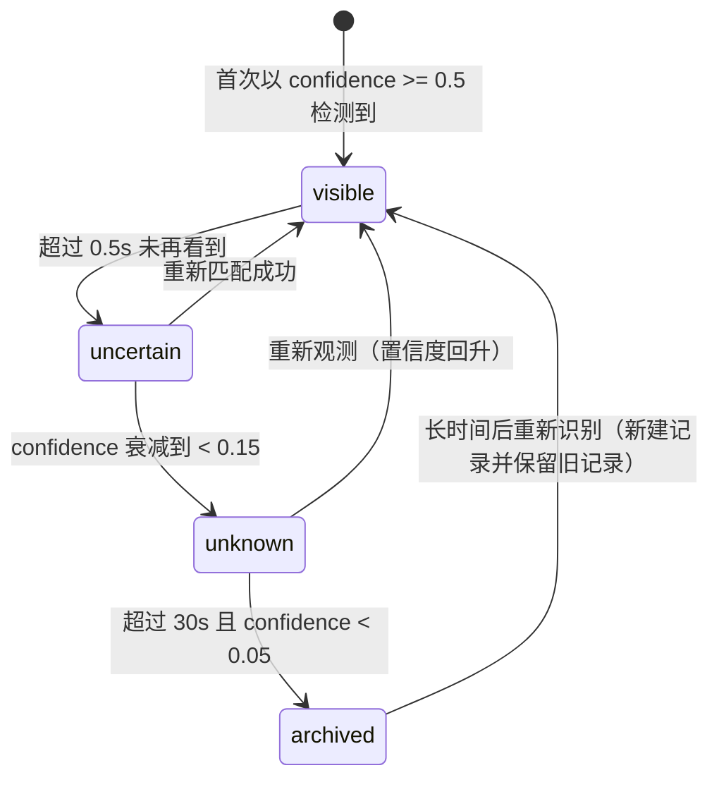

# 01｜感知与信念：Camera → Observation → PerceptionSnapshot → Belief

> 数据流权威定义：`Camera → Observation → PerceptionSnapshot → BeliefState`
> 工程落地版本见 `落地方案/01_第一阶段_相机-视觉-理解闭环.md`。

---

## 1. 目标与边界

这一层的任务不是"让 Camera 能看到画面"，而是把 Camera 变成角色**真正可使用的视觉传感器**，并把"看见的东西"变成一份**可以错、可以不确定、会随时间衰减**的主观信念。

```text
输入：Eye Camera 的 RGB / Depth / 相机姿态
输出：PerceptionSnapshot（几何权威） + SceneUnderstanding（语义权威） + BeliefState（主观世界模型）
```

它**不负责决定角色下一步做什么**。它只回答四个问题：

1. 这一帧里有什么？
2. 它在屏幕哪里、大概多远、在不在动？
3. 从语义上这里发生了什么？
4. 我*认为*世界现在是什么样，以及我有多确定？

---

## 2. 两级理解

### 2.1 快理解 Fast Vision —— "这一帧有什么，在哪里"

回答层次：几何与身份。输出形态：结构化、可逐帧比较。

| 能力 | 要点 | 输出字段 |
| --- | --- | --- |
| 检测 | 单阶段检测器（YOLO 系），输入 640，`conf ≥ 0.35`，类别白名单 + `other` 兜底 | `label` `confidence` `bbox_xyxy` |
| 跟踪 | 常驻跟踪器（ByteTrack / BoT-SORT），顺序送帧、`persist=True` | `track_id` `track_age_s` `frame_gap` |
| 深度 / 三维 | ROI 稳健深度 + 内参反投影（或射线自检模式） | `depth_m` `world_position` `position_confidence` |
| 运动 | bbox 中心位移 + 深度变化 + 相机自运动补偿 | `moving` `velocity_hint` |
| 空间关系 | 归一化 uv 上的上下左右 / 前后 / 包含 / 最近邻 | `relations[]` |
| 视觉事件 | 新 track、track 丢失、画面突变 | `vision_events[]` |

### 2.2 仔细理解 Slow Vision / VLM —— "这里发生了什么"

回答层次：语义与解释。输出形态：低频、语言描述 + 结构化假设 + 显式不确定性。

触发条件（满足任一即触发，受预算与冷却约束）：

| 触发信号 | 判定方式 | 优先级 |
| --- | --- | --- |
| 出现未知物体 | `label == "other"`，或 track 与所有 belief 匹配失败且持续 > 1.0 s | 高 |
| 第一次进入新区域 | 相机世界位置进入未记录的空间格（2 m 网格） | 中 |
| 场景大面积变化 | 相邻关键帧检测集合变化率超阈值 | 中 |
| 快理解长期低置信度 | 同一 track 连续 1.5 s `confidence < 0.5` | 中 |
| 上层 / 人类显式请求 | `slow.request` 消息（阶段二 `LookAt` / `Inspect` 会用它） | 最高 |
| 快理解连续失败 | 连续 3 次 `PERCEPTION_*` 错误 | 低 |

预算与冷却（必须硬编码，否则会刷爆模型与日志）：

```text
同一触发信号冷却      ≥ 10 s
同一区域未知物触发    ≥ 20 s
全局频率上限          ≤ 6 次 / 分钟
单次超时              6 s（超时即放弃，不影响快理解）
连续失败熔断          3 次失败 → 暂停 5 分钟
```

**抑制幻觉的三条硬规则：**

1. 只描述画面中**有像素证据**的内容；任何推断必须落在 `object_hypotheses`，不能混进 `scene_summary`。
2. 不确定的东西必须写进 `uncertainties`，不允许用模糊措辞掩盖。
3. **不允许输出坐标数字。** 几何一律由快理解提供；方位只允许粗粒度方位词并写在 `relations` 里。

### 2.3 两级如何协作

| 情形 | 快理解 | 仔细理解 | 合并后对外 |
| --- | --- | --- | --- |
| 常规观察 | 正常输出 | 不触发 | 只有几何快照，`scene_summary = null` |
| 未知物体出现 | `other` + 位置 | 触发一次："这可能是…" | 几何用 fast，语义用 slow（`source="vlm"`） |
| 低置信度 | 低 `confidence` | 触发一次，尝试用上下文解释 | 保留低置信度，不因语义描述而抬高 |
| 场景突变 | 变化事件 | 触发一次 | 同上 |
| 显式请求 | 照常 | 立即触发，可覆盖冷却（受全局上限约束） | 同上 |
| 仔细理解超时 / 失败 | 照常 | 放弃，记 `SLOW_*` | 完全不阻塞，快照照常产出 |

**合并铁律：冲突时按字段归属决定，不按时间新旧决定。**

| 字段 | 归属 | 仔细理解能否写 |
| --- | --- | --- |
| `bbox` `center_uv` `depth_m` `world_position` `moving` `track_id` | Fast（几何 / 身份） | **不能** |
| `label` | Fast 优先 | 只能写 `label_hint`，且仅当原 `confidence < 0.6` |
| `scene_summary` `notable_events` `uncertainties` | Slow 独占 | 只有它能写 |
| `object_hypotheses` `relations` | Slow 追加 | 追加，不删除 fast 结论 |

---

## 3. 采集：Unity 端

### 3.1 场景层级

```text
UnityChan
└── Head
    └── EyeSensorRoot          （视觉传感器根：独立于骨骼，方便调参与替换）
        └── EyeCamera          （Camera：targetTexture = EyeRT）
```

阶段一若还没有角色，把 `EyeSensorRoot` 挂在空物体上即可；接入角色后整棵子树挂到 `Head` 下，代码不用改。

### 3.2 默认参数

| 参数 | 默认值 | 说明 |
| --- | --- | --- |
| RenderTexture | 640×360，`R8G8B8A8_UNorm` | 先保证链路，再按需要提到 960×540 |
| 采集频率 | 10 Hz | 与渲染解耦；降级时自动降到 5 Hz |
| Camera FOV | 65°（垂直） | 决定内参，改动后必须重跑重投影自检 |
| Near / Far | 0.15 / 45 | 贴合场景，避免深度精度浪费 |
| JPEG quality | 80 | 70～85 区间够用 |
| 上行队列 | 2 帧 | 满则丢最旧 |
| 下行结果队列 | 4 条 | 满则丢最旧 |
| 结果过期阈值 | 帧龄 > 500 ms 或落后 8 帧 | 超龄结果直接丢 |

### 3.3 为什么用 RenderTexture + AsyncGPUReadback

Camera 输出写入 `RenderTexture`；不要在实时链路里每帧同步 `ReadPixels()`，优先用 `AsyncGPUReadback` 让 GPU→CPU 回读异步完成。它会引入少量帧延迟，但避免 CPU/GPU 相互等待。

```csharp
using Unity.Collections;
using UnityEngine;
using UnityEngine.Rendering;

public sealed class EyeCameraSensor : MonoBehaviour
{
    [SerializeField] Camera eyeCamera;
    [SerializeField] RenderTexture target;      // R8G8B8A8_UNorm, 640x360
    [SerializeField] FrameCaptureScheduler scheduler;
    [SerializeField] PerceptionTransport transport;
    [SerializeField, Range(50, 95)] int jpegQuality = 80;

    void Awake() => eyeCamera.targetTexture = target;

    void Update()
    {
        if (!scheduler.TryBeginCapture(out long id, out double captureTime)) return;

        CameraPose pose = CameraPose.From(eyeCamera, captureTime);

        // 显式指定目标格式，避免 RT 的 GraphicsFormat 与编码器要求不一致。
        AsyncGPUReadback.Request(target, 0, TextureFormat.RGBA32, request =>
        {
            scheduler.EndCapture();
            if (request.hasError) { transport.ReportCaptureError(id, "TRANSPORT_READBACK_ERROR"); return; }

            NativeArray<byte> rgba = request.GetData<byte>();
            using NativeArray<byte> jpg = ImageConversion.EncodeNativeArrayToJPG(
                rgba, GraphicsFormat.R8G8B8A8_UNorm,
                (uint)target.width, (uint)target.height, 0, jpegQuality);

            // callback 结束后 request 数据不再有效，必须先拷贝再入队。
            transport.EnqueueFrame(id, captureTime, pose, jpg.ToArray());
        });
    }
}
```

关键点：

1. Unity 主线程不等待 Python；
2. 视觉发送频率独立于渲染频率；
3. 结果必须带 `frame_id`；
4. 发送队列只保留"最新若干帧"，不要无限堆积；
5. Python 慢时丢旧帧，而不是拖死 Unity；
6. `GraphicsFormat` 的 sRGB 开关要与项目色彩空间一致（Linear 下不一致会导致颜色偏差）。

---

## 4. 传输与背压

### 4.1 演进路径

```text
MVP：       HTTP multipart（易用 curl / Postman 验证）
实时：      WebSocket（JSON metadata + JPEG 二进制，靠 frame_id 对齐）
不要做：    JPEG Base64 塞进 JSON（体积 +33%，多一次拷贝）
```

自定义二进制包头（可选）：

```text
| magic | version | frame_id | metadata_len | image_len | metadata | image |
```

### 4.2 背压策略

```text
Unity Capture Queue: max 2~3 帧
Python Ingest Queue: max 1~2 帧
队列满 → drop oldest, keep newest
```

因为这是**在线感知**，新鲜度通常比逐帧完整性更重要。

### 4.3 顺序性与会话

```text
1. 快理解必须单线程顺序消费，不允许并发处理多帧（会破坏跟踪器的帧序假设）
2. 丢帧后必须通知跟踪器"发生了跳帧"，跟踪器据此放宽 gate 并降低该 track 置信度
3. 仔细理解是独立 worker，与快理解完全解耦
4. 服务重启必须发 session_started；Unity 侧据此重置 active_track_id 关联
```

启动顺序：**先起 Fast 服务，再起 Unity**。跟踪器有状态，若顺序颠倒，`track_id` 会从头重排，Belief 关联会错乱。

---

## 5. 2D → 3D 的三档模式

| 模式 | 做法 | 用途 | 限制 |
| --- | --- | --- | --- |
| Mode A 射线求交 | Python 返回 `center_uv`，Unity `Camera.ViewportPointToRay` + `Physics.Raycast` | 开发期自检、验证坐标链 | 属于"上帝辅助"；bbox 中心不一定落在目标上 |
| Mode B Unity 深度（**默认**） | bbox 内缩 ROI 取深度中位数，用内参反投影到世界系 | 有真实深度传感器语义，误差可控 | 依赖 URP Depth Texture 可用 |
| Mode C 严格视觉 | 单目深度 + 跟踪 + 相机运动估计三维 | 研究终点，可完全脱离真值 | 位置误差大，必须配合"注视→接近→重看→细化" |

Mode B 细节：

```text
1. Python 返回 center_uv + bbox
2. Unity 在 bbox 内缩 25% 的 ROI 上取深度
3. 取 ROI 内有效深度的中位数（剔除 0 / 背景 / 远于 far*0.98 的值）
4. 用内参把 (u,v,depth) 反投影到相机空间，再变换到世界系
5. 计算重投影误差，作为 position_confidence 的输入
```

**为什么用 ROI 中位数：** 中心单点极易落在背景、桌面或物体边缘外；ROI 中位数对遮挡与边缘更鲁棒。

### 5.1 内参与坐标换算（约定，不要每次重新发明）

```text
- uv 归一化 0~1；跨进程一律使用左上原点，Unity 收到后翻回自身习惯
- 深度 d 定义为沿相机前方（相机空间 z）的距离，单位米

aspect = W / H
fy = (H / 2) / tan(fovY / 2)
fx = fy

反投影：
  x_cam = (u - 0.5) * W / fx * d
  y_cam = (v - 0.5) * H / fy * d
  worldPos = camPos + camRot * (x_cam, y_cam, d)
```

```csharp
public static Vector3 Unproject(Vector2 uv, float depthM, CameraPose pose, float fovYDeg)
{
    float halfFov = fovYDeg * 0.5f * Mathf.Deg2Rad;
    float t       = Mathf.Tan(halfFov);
    float aspect  = (float)pose.Width / pose.Height;

    float x = (2f * uv.x - 1f) * aspect * t * depthM;
    float y = (2f * uv.y - 1f) * t * depthM;
    return pose.Position + pose.Rotation * new Vector3(x, y, depthM);
}
```

### 5.2 重投影自检（最有价值的一项检查）

把估计出的 `world_position` 用同一套内参投影回屏幕，与原始 `center_uv` 比对：

```text
重投影误差_uv = |project(world_position) - center_uv|

≤ 1%   优秀（内参、坐标系、深度三者自洽）
≤ 3%   可接受
> 3%   坐标链有 bug：优先检查 v 轴方向 / fov 是垂直还是水平 /
       深度是"沿视线的 z"还是"欧氏距离" / 四元数左乘右乘

position_confidence = clamp(det_conf * depth_quality * exp(-err / 0.03), 0, 1)
```

**每天跑一次。** 在没有运动层的时候，这是唯一能证明"三维视觉真的可用"的手段。

---

## 6. 数据结构

### 6.1 Observation（单个对象的一次视觉观测，五元组）

```text
object      ：看到的是什么（label / track_id）
confidence  ：这次判断有多确信
timestamp   ：何时看到（capture_ts_ms，权威时间）
uncertainty ：不确定在哪里（位置置信度 / 遮挡 / 类别歧义）
source      ：来自哪个后端（fast / vlm / raycast_oracle / unity_depth …）
```

### 6.2 PerceptionSnapshot（一帧的几何权威）

```json
{
  "schema_version": "1.0",
  "session_id": "sess_7f3a",
  "source_frame_id": 18322,
  "capture_ts_ms": 1789891200123,
  "result_ts_ms": 1789891200171,
  "infer_ms": 44,
  "camera_pose_at_capture": {
    "position": [1.20, 1.62, 3.40],
    "rotation_xyzw": [0.0, 0.0, 0.0, 1.0]
  },
  "objects": [
    {
      "track_id": 12,
      "label": "cup",
      "label_source": "fast",
      "confidence": 0.94,
      "bbox_xyxy": [381, 122, 447, 238],
      "center_uv": [0.647, 0.500],
      "bbox_area_ratio": 0.028,
      "depth_m": 1.83,
      "depth_source": "unity_depth",
      "world_position": [3.20, 0.82, 1.40],
      "position_confidence": 0.86,
      "moving": false,
      "track_age_s": 4.2,
      "visibility": "visible"
    }
  ],
  "scene": { "novelty": 0.18, "major_change": false, "unknown_object_count": 0 },
  "vision_events": [
    { "type": "TRACK_APPEARED", "track_id": 12, "ts_ms": 1789891200170 }
  ],
  "warnings": []
}
```

字段规则：

- **两个置信度必须分开**：`confidence`（"这确实是个杯子"）与 `position_confidence`（"它确实在这个三维位置"）。前者决定是否写 Belief，后者决定能否支撑 `Reach`。
- `center_uv` 归一化，避免分辨率耦合。
- `world_position` 允许为 `null`：估计失败就是失败，不编造。
- `bbox_area_ratio` 是小目标保护与深度可信度的重要输入。
- **绝不返回 Unity 实例 ID。**
- `depth_source ∈ {raycast_oracle, unity_depth, mono_depth, none}`，便于按来源分组统计误差。

### 6.3 SceneUnderstanding（一次仔细理解的语义权威）

```json
{
  "schema_version": "1.0",
  "request_id": "slow_0091",
  "trigger": "unknown_object",
  "source_frame_ids": [18322, 18310, 18297],
  "scene_summary": "桌面上有一个红色杯子，杯子旁边有一本书。",
  "notable_events": ["桌面出现了新物体"],
  "object_hypotheses": [
    { "track_id": 17, "hypothesis": "可能是一个外卖杯", "confidence": 0.55,
      "evidence": "圆柱形，白色杯身，位于桌面右侧" }
  ],
  "relations": [
    { "subject_track_id": 17, "relation": "ON_TOP_OF", "object_track_id": 8 }
  ],
  "uncertainties": ["无法确认杯子是否装有液体"]
}
```

---

## 7. Belief：主观世界模型

### 7.1 与 WorldTruth 的严格分离

```text
WorldTruthState（Unity 真值）
  Door.locked = true
  Cup.position = ...
  用途：Physics / Verifier / Debug / 实验评价

BeliefState（角色主观认知）
  我看见门是关着的
  我不知道它是否锁住
  我上次看到杯子在厨房桌上
```

**Brain 的正常规划输入只能以 BeliefState 为主。** 否则角色虽然有相机，大脑仍在偷读 Unity 场景，第一人称视觉就失去意义。

### 7.2 结构

```json
{
  "schema_version": "1.0",
  "updated_ts_ms": 1789891205000,
  "objects": [
    {
      "belief_id": "visual_track_12",
      "label": "cup",
      "label_confidence": 0.94,
      "semantic": {
        "summary": "桌面上有一个红色杯子",
        "source": "vlm",
        "updated_ts_ms": 1789891204801,
        "confidence": 0.7
      },
      "last_seen_ts_ms": 1789891200123,
      "last_position": [3.20, 0.82, 1.40],
      "position_confidence": 0.86,
      "visibility": "visible",
      "active_track_id": 12,
      "properties": { "color": "red" },
      "uncertainties": ["是否装有液体"]
    }
  ],
  "unmatched_tracks": [17]
}
```

### 7.3 可见性状态机



### 7.4 衰减与匹配

```text
confidence(t) = confidence_at_last_seen * exp(-(t - last_seen_ts) / tau)
tau 默认 4000 ms（可配 2～8 s）

无观测时保持 last_position；一旦进入 unknown，
该位置只能用于"去看看"（Search），不能直接用于 Reach。
```

匹配规则（`track_id` ↔ `belief_id`）：

```text
1. track_id 与某 belief 的 active_track_id 相同                  → 直接更新
2. 否则 (label 相同) 且 (预测位置距离 < gate) 且 (间隔 < 1.5s)     → 关联并更新 active_track_id
3. 否则                                                          → 新建 belief；label 未知时发 NOVEL_OBJECT
4. 位置跳变 > gate（默认 1.5 m）且 bbox_area_ratio 未显著变化     → 视为可疑：
   不移动 belief，标 visibility = uncertain，写警告日志
```

### 7.5 不该更新 Belief 的情况（否则会写出一个"抖动放大器"）

```text
- confidence < 0.35 的检测：不新建 belief（只累加低置信度计数）
- 判定为 stale 的结果：完全不进入 Belief
- position_confidence < 0.2：更新 label 与 last_seen，但不动 last_position
- 单帧内重复检测（IoU > 0.6）：只保留置信度最高的一个
- 仔细理解的语言描述：只能写 semantic 字段
```

---

## 8. 视觉事件（驱动 Runtime 的接口）

| 事件 | 触发条件 | 下游意义 |
| --- | --- | --- |
| `PERCEPTION_UPDATED` | 每份快照进入融合层 | 状态刷新心跳（低频，不代表要决策） |
| `TRACK_APPEARED` | 新 `track_id` 出现 | 可能触发好奇 → 新 Goal |
| `TARGET_LOST` | 某 `track_id` 连续 2.0 s 未出现 | Skill 失败码 `TARGET_LOST` |
| `TARGET_REACQUIRED` | 消失后高置信度重现并匹配成功 | 恢复被打断的 Skill |
| `NOVEL_OBJECT` | `label == "other"` 或无法匹配任何 belief | 触发仔细理解、触发好奇 |
| `SCENE_CHANGED` | `major_change == true` | 触发仔细理解，可能使旧 plan 失效 |
| `PERCEPTION_DEGRADED` / `PERCEPTION_RECOVERED` | 连续超时 / 恢复 | 上层降级或恢复 |
| `SLOW_UNDERSTANDING_READY` | 仔细理解产出 | 追加语义，按重要性写记忆缓冲 |

---

## 9. 时序正确性与结果失效

```text
采样点：
  capture_ts_ms   取帧时刻（唯一权威时间）
  infer_ms        推理耗时
  result_ts_ms    结果产出时刻
  receive_ts      Unity 收到时刻

失效判定（满足任一即丢弃或降权）：
  A. 落后：current_frame_id - source_frame_id > 8              → 丢弃
  B. 过老：now - capture_ts_ms > 500 ms                        → 丢弃
  C. 相机移动：|camPos_now - camPos_at_capture| > 0.30 m        → 丢弃
  D. 相机转动：angle(camRot_now, camRot_at_capture) > 15°       → 丢弃
  E. 当前 Skill 目标已切换                                       → 丢弃

降权：位姿变化处于阈值 50%～100% 之间 → position_confidence *= 0.5
```

**"结果过旧"与"目标丢失"必须区分：** 前者是"我的信息过期了"，只丢弃结果、**不**产生 `TARGET_LOST`；后者是"世界可能变了"，才驱动 Belief 状态迁移。混在一起会让 Belief 频繁误报丢失。

---

## 10. 性能预算与降级

```text
640×360 RGBA  ≈ 0.88 MiB/帧；10 Hz ≈ 8.8 MiB/s
JPEG(80) 通常降一个数量级；编码本身有 CPU 成本

端到端（同机 localhost）：
  回读 5~20 ms + 编码 3~8 ms + 传输 <2 ms + 推理 20~60 ms + 回传 <2 ms
  → 中位数 ≈ 50 ms，p95 ≤ 120 ms（超过即视为掉出实时域，标 stale）
```

性能不够时依次尝试：

```text
1. 降发送频率  2. 降分辨率  3. 只发 ROI  4. 只在画面变化时发送
5. 把轻量模型移到端上（ML-Agents 2 自带 Barracuda 推理通道）
6. 再考虑硬件编码 / 视频流
```

降级策略：

| 故障 | 行为 |
| --- | --- |
| 模型未就绪 / 加载失败 | 返回 `PERCEPTION_MODEL_UNAVAILABLE`，Unity 保留上一次快照并标 `stale=true` |
| 单帧推理超时 | 丢弃该帧，不重试（重试只会加剧积压） |
| 连续 N 帧（默认 10）超时 | 发 `PERCEPTION_DEGRADED`，面板转黄，采集频率降到 5 Hz |
| 检测置信度整体偏低 | 继续工作，压低 `position_confidence`，并向仔细理解投递低置信度触发 |
| Python 完全挂掉 | Unity 进入离线模式：只取帧、只画本地调试，不发送，持续退避重连 |

---

## 11. 可观测性

### 11.1 Debug 面板

```text
[链路]     EyeCam 60fps | Capture 10.0Hz | Sent 9.8/s | Dropped 3
           RTT p50 62ms p95 108ms | inflight 1/2 | State CONNECTED
[快理解]   frame_id 18322 | infer 44ms | objects 3 | unknown 1
           cup    track=12 conf=.94 uv(.65,.50) d=1.83m pos_conf=.86 err=0.8%
           table  track=8  conf=.88 uv(.41,.72) d=2.40m pos_conf=.79 err=1.4%
           other  track=17 conf=.52 uv(.78,.44) d=1.21m pos_conf=.41 err=2.9%
[仔细理解] last 12.4s ago (unknown_object) | ok 4 / fail 1 | next allowed in 7.6s
           summary: 桌面上有一个红色杯子，杯子旁边有一本书。
[Belief]   cup_12 visible conf .86 pos (3.20,0.82,1.40)
           door_3 unknown last_seen 42s ago (archived in 18s)
           unmatched_tracks: [17]
[事件]     PERCEPTION_UPDATED TRACK_APPEARED(17) NOVEL_OBJECT(17)
```

Scene 视图画：bbox、`track_id`、目标中心点、深度重建点、重投影点（与中心点比对即可肉眼看出坐标链问题）、ROI 深度取样框、当前 Gaze Target。

### 11.2 遥测（JSONL）

| 指标 | 用途 |
| --- | --- |
| `capture_hz` / `sent_hz` / `dropped_frames` | 采集与背压是否健康 |
| `rtt_p50` / `rtt_p95` / `infer_ms` | 实时性是否达标 |
| `objects_count` / `unknown_count` / `avg_confidence` | 检测质量 |
| `track_churn` | 跟踪稳定性（新 track 速率 / 平均存活数） |
| `stale_ratio` | 时序健康度 |
| `slow_trigger_count` / `slow_fail_count` / `slow_latency_p95` | 仔细理解成本与稳定性 |
| `reproject_error_p50` / `p95` | 坐标链质量 |
| `belief_count` / `visible_ratio` | 主观世界模型规模与新鲜度 |

告警阈值：`stale_ratio > 10%` 持续 30 s、`rtt_p95 > 200 ms` 持续 30 s、`track_churn > 2.0/min`、`reproject_error_p95 > 3%`、`slow_fail_count` 连续 3 次。

---

## 12. 实施结论

这一层第一版不要追求"真正人眼级理解"，先保证：

```text
稳定取帧 + 不阻塞 + 检测稳定 + 结果有时间戳 + 能得到可用 3D 目标 + 能更新 Belief
```

只要"看见杯子 → 转头看杯子"跑通，视觉、通信、坐标、时序、IK 五条关键链就已经贯通。量化验收标准见 `07_路线图_阶段划分与验收.md`，工程细节见 `落地方案/01_第一阶段_相机-视觉-理解闭环.md`。
