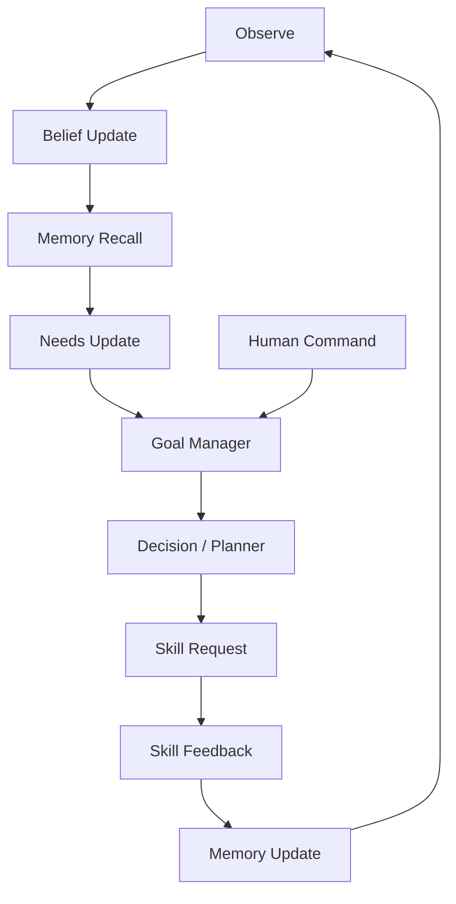

# 02｜Agent 运行时：状态、事件、快决策与 LLM 边界

> 这一层是"生命感"的工程实现：角色持续感知自己的身体、环境、需求、目标与经历，并让这些状态影响下一步行为。
> 它**不应该**被实现成 `while True: ask_llm("你现在想干什么？")`。

---

## 1. 运行时形态

正确结构是一个持续运行的、**事件驱动**的 Agent Runtime：



采纳的三条外部传统：

| 传统 | 采纳内容 |
| --- | --- |
| LangGraph 类状态图运行时 | 显式状态、节点/边、事件循环、持久状态、检查点与可重放 |
| JEV / System One | 类型化快速决策（Typed Decision），确定性策略优先于 LLM |
| 机器人分层 | perception / planning / control 分离，频率域分离 |

---

## 2. AgentState

Python 侧维护唯一权威状态：

```python
from dataclasses import dataclass, field

@dataclass
class AgentState:
    identity: dict                  # 稳定人设（不每次由 LLM 生成）
    needs: dict[str, float]         # 数值由确定性逻辑维护
    current_goal: dict | None
    belief_state: dict              # 主观世界模型（来自感知层）
    body_state: dict                # 身体语义状态（来自运动层）
    working_memory: list[dict] = field(default_factory=list)
    active_skills: list[dict] = field(default_factory=list)
    long_term_memory: dict | None = None
    human_commands: list[dict] = field(default_factory=list)
    events: list[dict] = field(default_factory=list)
```

逻辑上包含：

```text
Identity / Personality
Needs
CurrentGoal
BeliefState
BodyState
WorkingMemory
LongTermMemory
ActiveSkills
HumanCommands
Events
```

运行时把所有变化都表达为**事件**，而不是每帧重算全身状态。

```text
PerceptionUpdated
SkillSucceeded / SkillFailed
HumanCommand
NeedThresholdCrossed
TargetLost / TargetReacquired
GoalCompleted / GoalFailed
Timer
MemoryConsolidated
```

### 2.1 事件循环（含检查点）

```python
import asyncio

async def agent_loop(runtime):
    while True:
        event = await runtime.events.get()

        runtime.update_state(event)                       # 状态更新
        runtime.checkpoint()                              # 可重放：落盘关键状态

        if runtime.should_reconsider_goal(event):
            runtime.goal_manager.update()

        if runtime.needs_plan(event):
            decision = await runtime.decide(runtime.context())
            await runtime.dispatch(decision)
```

```text
Event → State Update → Decision Node → Planning Node → Skill Execution → Verification → Memory
```

**关键点：LLM 只在 `runtime.needs_plan(event)` 为真时才被调用**，而不是每个 tick。

---

## 3. 决策层：快决策 + 慢推理

决策层由两部分组成，职责严格分开：

```text
Decision Layer
├── Fast Policy（JEV 风格，确定性，微秒～毫秒级）
└── LLM Planner（慢速推理，秒级，可失败、可降级）
```

### 3.1 Fast Policy：类型化决策

输入 `State + Constraints`，输出**类型化决策**：

```json
{ "decision": "WALK_FIRST", "confidence": 0.93, "reason": "target beyond comfort reach" }
```

它最适合承担的三件事：

```text
Goal Arbitration   —— 多个目标同时存在时选一个
Skill Selection    —— 在当前状态下选哪个 Skill
Failure Recovery   —— 用确定性表处理已知失败
```

典型规则表（可配置、可测试、可复现）：

| 情形 | 决策 |
| --- | --- |
| `TARGET_LOST` | `SEARCH` / `SCAN_AREA` |
| `OUT_OF_REACH` | `MOVE_CLOSER` → `RE_OBSERVE` → `RETRY_REACH` |
| `PATH_BLOCKED` | `REPLAN_PATH` → `WAIT` → `ASK_HUMAN` |
| `HUMAN_STOP` | 立即 `CANCEL_ALL`，进入 `IDLE` |
| `NEED_CURIOSITY_HIGH` 且无用户任务 | `EXPLORE` |
| `BALANCE_UNSTABLE` | `STABILIZE`（暂停上层意图） |

快决策层必须是**纯函数式、无副作用、可单测**的：给定同样的输入，得到同样的输出。

### 3.2 LLM Planner：只做不能确定性解决的事

适合：

- 自然语言命令理解；
- 长任务拆解；
- 未知情境推理；
- 从记忆中总结；
- 失败后的策略重规划；
- 对话。

不适合（**禁区**）：

- 50 Hz 控制；
- 关节角 / IK；
- 物理碰撞判断；
- 精确计时；
- 判断动作是否真的成功；
- 维护连续数值状态（Needs / 置信度 / 位置）。

### 3.3 结构化输出

无论用哪家 LLM，输出都必须被 schema 约束：

```python
from pydantic import BaseModel
from typing import Literal

class SkillCall(BaseModel):
    skill: str
    args: dict

class PlanDecision(BaseModel):
    action: Literal["START_SKILL", "WAIT", "ASK_HUMAN", "REPLAN"]
    skill_call: SkillCall | None = None
    reason: str
```

```text
解析失败 → 不要执行自由文本 → retry / fallback 到 Fast Policy
```

### 3.4 决策来源必须可审计

每次动作都要记录它是怎么来的：

```text
Decision Source: FAST_POLICY | LLM | HUMAN_COMMAND | FALLBACK
```

否则线上出现"角色突然做了奇怪的事"时无法归因。

---

## 4. 规划：只规划 Skill，不规划骨骼

Planner 输入：

```text
Current Goal
BeliefState
BodyState
Relevant Memory
Available Skills（来自 Skill Registry）
Recent Failures
```

输出：

```json
{
  "goal_id": "goal_88",
  "reason": "杯子距离较远，先接近再伸手",
  "steps": [
    { "skill": "LookAt",  "args": { "target": "cup_12" } },
    { "skill": "WalkTo",  "args": { "target": "cup_12", "stop_distance": 0.7 } },
    { "skill": "LookAt",  "args": { "target": "cup_12" } },
    { "skill": "Reach",   "args": { "target": "cup_12", "hand": "RIGHT" } },
    { "skill": "Grasp",   "args": { "target": "cup_12" } }
  ]
}
```

**禁止 Planner 输出：**

```text
rotate right elbow 23 degrees
move left foot 0.18 m
```

这些属于运动层（见 `05_运动系统_RigGraph与全身控制.md`）。

---

## 5. 与 Unity 的异步关系

绝对不要：

```text
Unity Update() → await Python → await VLM → await LLM
```

正确做法：

```text
Unity 60 FPS        —— 永远用"最新有效意图"驱动表现
Motor 50 Hz         —— 本地闭环
Perception 5~15 Hz  —— 独立链路
Brain               —— 事件触发，慢一点没关系
```

Python 返回慢了怎么办：

- 旧感知：丢弃（见 `01` 的结果失效规则）；
- 旧 Plan：可取消（`skill.cancel`）；
- Unity：继续物理模拟，不等待；
- Safety / STOP：Unity 本地也必须能独立执行，不依赖 Python。

---

## 6. Safety / Sanity Guard

Brain 输出 Skill 之前，先做**确定性**守卫检查：

```text
目标存在吗？          （Belief 里有这个 belief_id / track_id）
Skill 是否注册？      （Skill Registry 里查得到）
参数类型对吗？        （schema 校验）
是否违反资源锁？      （见 04 的资源锁）
是否超过动作范围？    （粗可达性判断）
是否处于 STOP 状态？  （人类急停优先）
```

**LLM 说"成功"没有任何意义。只有 `Unity Verifier → SUCCESS` 才算成功。**

---

## 7. 失败恢复

失败必须结构化：

```json
{
  "skill": "Reach",
  "target": "cup_12",
  "code": "OUT_OF_REACH",
  "details": { "distance_m": 0.96, "max_comfort_reach_m": 0.78 }
}
```

确定性恢复优先（不需要 LLM）：

```text
OUT_OF_REACH        → WalkTo closer → Re-observe → Reach again
POSITION_UNCERTAIN  → LookAt / Inspect
TARGET_LOST         → Search / ScanArea
IK_LIMIT            → Spine lean / step closer
TIMEOUT             → 记录后重试一次，仍失败再升级到 LLM
```

只有"复杂失败"（规则表里没有的）才交给 LLM 重新规划。

---

## 8. Debug 面板

```text
IDENTITY
UnityChan / curious / cautious

NEEDS
curiosity 0.72 | safety 0.95 | task 0.40

DECISION SOURCE
FAST_POLICY (LLM idle 42s)

BELIEF
cup_12 visible at (3.20, 0.82, 1.40) conf .86
door_3 closed, lock unknown

CURRENT GOAL
Inspect cup_12

PLAN
1 LookAt ✓   2 WalkTo running   3 Reach pending

ACTIVE SKILLS / LOCKS
WalkTo (ROOT+LEGS) | LookAt (GAZE)

MEMORY RETRIEVED
- kitchen contains table
- previous reach failed when too far

HUMAN COMMAND
none
```

这样才能区分：没看见 / 看见但 Belief 错 / Goal 没生成 / Plan 错 / Skill 错 / Motor 错 / Verifier 错。

---

## 9. 实施结论

这一层最重要的不是"接上一个更强的 LLM"，而是先建立：

```text
可观察状态 + Belief + Needs + Goal + 可验证 Skill + 事件驱动 Runtime + 分层 Memory
```

验收的最低门槛：**Brain 不接 LLM 也能独立运行**（发现未知物体 → 好奇上升 → 生成 Inspect 目标 → Now/LookAt/WalkNear → 收到 Skill 反馈）。细节见 `07_路线图_阶段划分与验收.md`。
