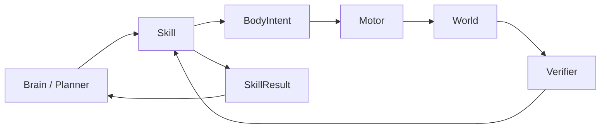

# 04｜Skill 系统：Brain 与 Motor 之间的可验证行为语言

> Skill 是整个项目最关键的"中间语言"。
> Brain 不直接操作骨骼；Motor 也不理解"探索厨房"这种高层语义。

---

## 1. 定位与边界



一句话：

> **Skill 描述一个可启动、可 Tick、可取消、可验证、可失败恢复的能力。**

### 1.1 什么是 Skill，什么不是

| 是 Skill | 不是 Skill（属于 Motor） |
| --- | --- |
| `LookAt(target)` `WalkTo(target)` `Reach(target, hand)` | 右肘转 20° |
| `Grasp(target)` `Place(target, surface)` | 右手 Target 每帧插值 |
| `Inspect(target)` `Explore(area)` `ScanArea` | 左脚 swing phase |
| `Wait` `AskHuman` `RecallMemory` | 骨盆补偿 4 cm |

---

## 2. Skill Contract

所有 Skill 统一契约：

```text
CanStart(context, args) -> (bool, reason)
Start(context, args)
Tick(context, dt)
Cancel(reason)
GetStatus()
BuildResult()
```

状态机：

```text
Idle → Starting → Running → Succeeded
                          ↘ Failed
                          ↘ Cancelled
```

```csharp
public enum SkillStatus { Idle, Starting, Running, Succeeded, Failed, Cancelled }

public interface ISkill
{
    string Name { get; }
    SkillStatus Status { get; }

    bool CanStart(SkillContext context, SkillArgs args, out string reason);
    void StartSkill(SkillContext context, SkillArgs args);
    void Tick(SkillContext context, float dt);
    void Cancel(string reason);
    SkillResult GetResult();
}
```

### 2.1 SkillResult：不要只返回 true / false

```csharp
[System.Serializable]
public class SkillResult
{
    public string skill;
    public bool   success;
    public string code;        // 结构化失败码，见 09
    public string message;
    public float  duration;
    public string targetId;
}
```

```json
{
  "skill": "Reach",
  "success": false,
  "code": "OUT_OF_REACH",
  "message": "target is 0.96m away",
  "duration": 1.42,
  "target_id": "cup_12"
}
```

**失败码比自然语言重要**，因为 Planner 可以直接据此做确定性恢复。

### 2.2 静态定义与运行实例分开

静态定义用 ScriptableObject：

```csharp
using UnityEngine;

[CreateAssetMenu(menuName = "VirtualHuman/Skill Definition")]
public class SkillDefinition : ScriptableObject
{
    public string   skillName;
    public float    timeoutSeconds = 5f;
    public string[] requiredResources;
    public string[] tags;
}
```

运行实例保存：`target` / `start_time` / `current_phase` / `retry_count` / 临时数据。

**不要把运行状态写回共享 asset。**

---

## 3. Precondition（启动前检查）

Precondition 失败不应该进入 `Running`。

```text
Reach：target known；position_confidence 足够；手空闲；
       未持有不兼容物体；大致可达或允许恢复
Grasp：手已接近目标；目标可抓；手空闲；存在抓取点
WalkTo：目标位置已知；路径可用；不处于急停状态
```

---

## 4. 资源锁（Resource Lock）

多个 Skill 不能同时抢同一个身体资源：

```text
GAZE / ROOT / LEFT_ARM / RIGHT_ARM / LEFT_HAND / RIGHT_HAND / SPINE / LEGS / FULL_BODY
```

| Skill | 锁定 | 可并行 |
| --- | --- | --- |
| `LookAt` | `GAZE` | 可与 `WalkTo` 并行 |
| `WalkTo` | `ROOT + LEGS` | 可与 `LookAt` 并行 |
| `Reach(RIGHT)` | `RIGHT_ARM`（可选 `SPINE`） | 不可与另一个右手 Skill 并行 |
| `Grasp(RIGHT)` | `RIGHT_HAND` | 需先持有 `RIGHT_ARM` |

**这就是"边走边看"与"边走边伸手"的区别所在。** 资源锁是并行的唯一依据。

---

## 5. Scheduler

职责：Skill 注册、启动、Tick、资源冲突、超时、取消、结果事件。

```csharp
void Update()
{
    foreach (var skill in activeSkills.ToArray())
    {
        skill.Tick(context, Time.deltaTime);

        if (skill.Status is SkillStatus.Succeeded
                          or SkillStatus.Failed
                          or SkillStatus.Cancelled)
        {
            ReleaseLocks(skill);
            Publish(skill.GetResult());     // 只发布一次
            activeSkills.Remove(skill);
        }
    }
}
```

---

## 6. Timeout

所有外部驱动的 Skill 都必须有超时：

```text
LookAt   2 s
Reach    4 s
Grasp    2 s
WalkTo   按路径长度动态估计
```

超时不是简单的"失败"，要返回具体原因：

```text
TIMEOUT_GAZE_NOT_CENTERED
TIMEOUT_MOTOR_NOT_SETTLED
TIMEOUT_PATH_BLOCKED
```

越具体越容易恢复。

---

## 7. Verifier：成功必须由世界确认

| Skill | 成功条件（Verifier） |
| --- | --- |
| `LookAt` | 目标在相机中 **且** 中心进入屏幕中央阈值 **且** 持续 3～5 帧 |
| `WalkTo` | `distance(root,target) ≤ stop_distance` **且** 速度低于阈值 |
| `Reach` | `distance(hand, grasp_point) ≤ tolerance` **且** 手速度足够小 |
| `Grasp` | 手确实持有目标 **且** 关节/接触建立 **且** 目标跟随手一小段时间 |
| `Place` | 已释放 **且** 物体在期望表面上 **且** 速度稳定 |

**Brain 不能自己说"我拿到了杯子"。** 只有 Verifier 说的算。

### 7.1 LookAt 是视觉闭环，不是"发过一次命令"

```text
好条件：目标重新出现在画面中央区域，并持续 N 帧
坏条件：我发过一次 LookAt 命令
```

---

## 8. 典型 Skill

### 8.1 LookAt

```text
AcquireTarget → CommandGaze → WaitCentered → Success
```

```csharp
public class LookAtSkill : ISkill
{
    public string Name => "LookAt";
    public SkillStatus Status { get; private set; }

    Vector3 target;

    public void StartSkill(SkillContext ctx, SkillArgs args)
    {
        target = args.worldPosition;
        ctx.gaze.LookAt(target);          // 只下发意图，不直接转骨骼
        Status = SkillStatus.Running;
    }

    public void Tick(SkillContext ctx, float dt)
    {
        if (ctx.vision.IsWorldPointCentered(target, 0.12f, frames: 4))
            Status = SkillStatus.Succeeded;
    }

    public void Cancel(string reason) => Status = SkillStatus.Cancelled;
}
```

### 8.2 Reach

```text
ResolveTarget → CheckReachability → KeepGaze → MoveHandTarget → Settle → Verify
```

失败码：`TARGET_LOST` / `POSITION_UNCERTAIN` / `OUT_OF_REACH` / `IK_LIMIT` / `COLLISION_BLOCKED` / `TIMEOUT`

恢复策略：

```text
OUT_OF_REACH        → Planner 插入 WalkTo
POSITION_UNCERTAIN  → 插入 LookAt / Inspect
TARGET_LOST         → Search / ScanArea
```

### 8.3 Grasp

**不要**写成 `hand.transform.SetParent(cup)` 然后宣布成功。

```text
Precondition（手已接近）
→ OpenHand
→ align grasp pose
→ close hand
→ attach / contact
→ lift test / follow test
→ Verifier
```

attach 成功但物体立即掉落 → `OBJECT_SLIPPED`，**不是 Success**。

### 8.4 WalkTo

Skill 只关心：`target` / `stop_distance` / `path progress` / `blocked` / `arrival`。

```text
PlanPath → Moving → Repath(optional) → Settling → Arrived
```

失败：`PATH_NO_ROUTE` / `PATH_BLOCKED` / `TARGET_MOVED` / `BALANCE_UNSTABLE` / `TIMEOUT`

Motor 关心的（落脚点、骨盆、平衡、速度）见 `05`。

### 8.5 Composite Skill

高层 Skill 可以组合基础 Skill，例如 `PickUp(target)`：

```text
LookAt → WalkTo(0.7m) → LookAt → Reach → Grasp → Lift
```

**建议第一版由 Planner 直接组合原子 Skill**，等行为稳定后再把常见序列封装成 Composite。

### 8.6 Cognitive Skill

Skill 不一定都是身体动作：

```text
ScanArea / Inspect / Search / Wait / AskHuman / RecallMemory
```

它们仍然必须有开始、完成、失败语义（例如 `Inspect` 触发 Slow Vision，`AskHuman` 产生交互事件）。

---

## 9. Skill Registry 与 API

Brain 不能凭空发明 Skill 名。启动时同步注册表：

```json
{
  "skills": [
    { "name": "LookAt", "args": { "target_id": "string" } },
    { "name": "Reach",  "args": { "target_id": "string", "hand": ["LEFT", "RIGHT"] } }
  ]
}
```

Planner 的 prompt / 规则表只暴露当前真正可用的 Skill。

跨进程协议（完整定义见 `08`）：

```json
{ "type": "skill.start", "request_id": "req_901", "skill": "Reach",
  "args": { "target_id": "cup_12", "hand": "RIGHT" } }

{ "type": "skill.result", "request_id": "req_901", "skill": "Reach",
  "status": "FAILED", "code": "OUT_OF_REACH", "details": { "distance_m": 0.96 } }

{ "type": "skill.cancel", "request_id": "req_901", "reason": "human_override" }
```

---

## 10. Skill 与 Belief / WorldTruth

```text
执行输入   ：主要来自 Belief target + BodyState
验证       ：可以使用 WorldTruthState / Physics / Collider / Joint
```

即：

```text
角色靠主观认知行动，系统靠客观真值验证。
```

这是本项目最重要的实验结构。

---

## 11. Skill 与视觉闭环

Manipulation Skill 不应该只在开始时看一次目标：

```text
LookAt target
→ Reach 30% → perception update → refine target
→ Reach 70% → perception update → refine
→ final approach → Verify
```

目标移动时：

```text
小位移 → 更新 target
大位移 → pause / replan
```

这才是 embodied closed loop。

---

## 12. Telemetry 与测试

每次 Skill 记录：

```json
{
  "skill": "Reach", "target_type": "cup", "duration_s": 1.82,
  "success": true, "retry_count": 1,
  "start_distance_m": 0.71, "final_error_m": 0.031
}
```

用途：调参、找失败模式、形成 Procedural Memory、训练 RL 策略、比较严格视觉与自检模式。

### 12.1 PlayMode 测试要点

```text
固定杯子 → Reach → SUCCESS
杯子移出范围 → Reach → OUT_OF_REACH
执行中删除目标 → TARGET_LOST
Reach 中 Human STOP → CANCELLED_BY_HUMAN
```

### 12.2 Scheduler 单测要点

```text
资源冲突是否拒绝 / Cancel 是否释放锁 / Timeout 是否结束 / Result 是否只发布一次
```

---

## 13. 第一版 Skill Library（不要一次做几十个）

```text
Perception  : LookAt / ScanArea / Inspect
Locomotion  : WalkTo / TurnTo / StepBack
Manipulation: Reach / Grasp / Release / Lift / Place
Cognitive   : Wait / AskHuman
```

---

## 14. 验收标准

Skill 层的成功标准不是"Skill 数量多"，而是每个 Skill 都满足：

```text
输入清楚 + 前置条件清楚 + 资源清楚 + 状态清楚
+ 可取消 + 有超时 + 成功可验证 + 失败有错误码 + 能被 Planner 恢复
```

只要这一层稳定，底层无论换成程序化 IK、RigGraph 约束还是 RL 策略，Brain 的接口都不需要推倒重来。
