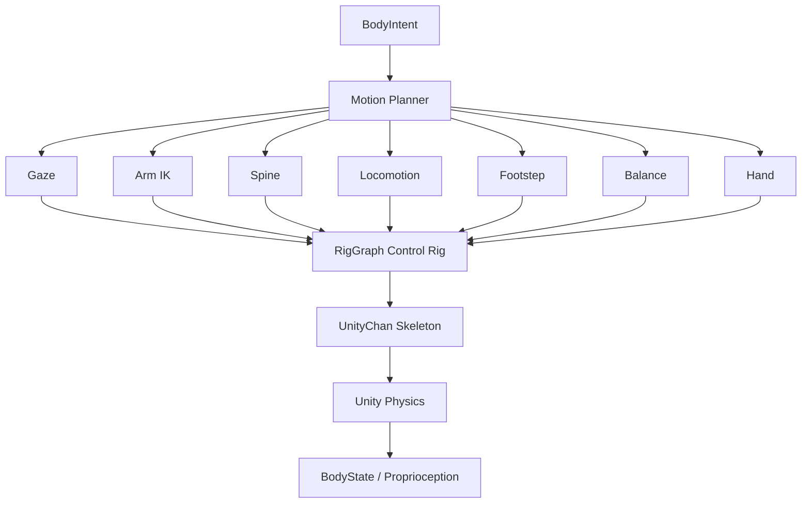

# 05｜运动系统：RigGraph 与全身控制

> 这一层是项目的"小脑 / 运动系统"。
> 技术基线：**团结 Rig Graph（`cn.tuanjie.riggraph` 1.0.0）**，不使用 Animation Rigging。

---

## 1. 核心原则

Brain **不应该**输出：

```text
左肩 +13°，右肘 +26°，头 +8°
```

而应该输出：

```text
LookAt(cup)
Reach(RIGHT_HAND, cup)
WalkTo(table)
Grasp(cup)
```

运动层负责把这些**意图**转换成连续、稳定、可取消的身体运动：



---

## 2. RigGraph 技术栈

### 2.1 组成

| 元素 | 名称 | 职责 |
| --- | --- | --- |
| 包 | `cn.tuanjie.riggraph` 1.0.0 | Rig Graph 运行时与编辑器 |
| 命名空间 | `Tuanjie.RigGraph.Runtime.RigGraphCore` | 运行时 API |
| 主组件 | `RigGraphManager`（AddComponent: `Rig Graph/Rig Graph Manager`） | 绑定 Animator，构建并驱动 PlayableGraph |
| 图资产 | `RigGraphAsset` / `ModularRigGraphAsset` | Control Rig 图（节点图，可复用/模块化） |
| 脚本机 | `RigGraphScriptMachine` | 承载与执行节点图 |
| 变量 | `RigGraphVariables`（`Rig Graph/Rig Graph Variables`） | 把图内参数暴露给 C#，是"上层 → 图"的主要通道之一 |
| 控制点 | `RigEffector`（`Rig Graph/Rig Effector`） + `RigEffectorsBuilder` | 运行时被程序驱动的控制点（手、脚、头、目标点） |
| 代码生成 | `graphCodeGenerate` + `NodeCodeGenerator` | 把节点图编译成 Job 调用，避免运行时反射开销 |
| 烘焙 | Bake Editor Window | 把解算结果烘成 AnimationClip，用于预览与回放 |
| 动画集成 | `AnimationRigGraphNode` / `AnimationModularRigGraphNode` | 在 AnimGraph 里插入骨骼姿态处理 |

**运行时不需要手写 IK 数学**：`RigGraphManager.Build()` 会为 Animator 创建一个独立 PlayableGraph（排序在后），把节点图的解算结果写回骨架。

### 2.2 节点库（本项目实际会用到的部分）

| 类别 | 节点 | 用途 |
| --- | --- | --- |
| 层级 IK | `Two Bone IK - Simplified`（Root / Middle / End / Goal / Hint Goal / Stretch / Weights） | 手臂、腿的两段 IK，直接按骨骼层级解算 |
| 层级 IK | `Two Bone IK`（Item A / Item B / Effector Item / Effector / Primary Axis / Pole Vector / Enable Stretch / Weight） | 显式指定双骨与极向量的版本 |
| 层级 IK | `Chain IK Constraint`（Root / Tip / Target / Tolerance / Max Iterations / Weight） | FABRIK 多骨链 IK（脊柱、手腕、尾巴类） |
| 全身 IK | `Full Body IK`（Root / Goals / Bound Bones / Freeze Root） | 多目标全身求解（手脚同时约束） |
| 瞄准 | `Aim Math`（Primary/Secondary Axis + Target + Space + Weights） | 注视、头部朝向、枪口对齐一类的朝向约束 |
| 变换 | `Set Transform`（控制点）、`Set Bone Transform`、`Get RigidTransform`、`Lerp Transform` | 读写控制点/骨骼，做平滑 |
| 限制 | `Limit Euler Angle` | 关节安全角限制 |
| 数学 | `Rotate Vector` / `Compute Normal` / `Multiply Quaternion` | 求解辅助 |
| 控制流 | `If` / `Sequence` / `Loop` / `Get|Set Variable` | 图内条件与参数 |
| 感知辅助 | `Ray Cast` / `Ray Cast All` | 地面探测、接触探测 |
| 时间 | `Get Delta Time` / `Get Smooth Delta Time` | 求解用时间 |
| 调试 | `Draw Line` / `Draw Sphere` / `Draw Wire Cube` | 在 Scene 里画 IK 目标与误差 |
| 曲线 | Splines 节点 | 轨迹类动作（可用可不用） |

### 2.3 Effector 与 LockState（运行时驱动的正确姿势）

```text
RigEffector.OffsetPosition / OffsetRotation      —— 相对偏移
RigEffector.SetPositionOffset(Vector3, LockState)
RigEffector.SetRotationOffset(Quaternion, LockState)
RigEffector.SetTransformOffset(Vector3?, Quaternion?, LockState)
RigEffector.ClearLockState() / ClearPosition() / ClearRotation()
RigEffector.lockState ∈ { Undefined, LockWorld, LockGlobal, LockLocal }
```

规则：

```text
1. 运行时只移动 Effector（或改 RigGraphVariables），不要直接乱改骨骼 Transform
2. LockWorld  = 偏移以世界系表达（最常用：把手 Target 放到世界某点）
   LockGlobal = 以角色根为参照（角色转身时目标跟随）
   LockLocal  = 以骨骼父级为参照
3. 不用的 Effector 必须 ClearLockState，否则会一直压制动画
```

### 2.4 从 Animation Rigging 迁移对照

| Animation Rigging（旧） | Tuanjie RigGraph（本项目） |
| --- | --- |
| `RigBuilder` + `Rig` 组件 | `RigGraphManager` + `RigGraphAsset`（Control Rig） |
| `TwoBoneIKConstraint` 组件 | `Two Bone IK - Simplified` / `Two Bone IK` 节点 |
| `MultiAimConstraint` 组件 | `Aim Math` 节点 + `Set Transform` |
| `ChainIKConstraint` 组件 | `Chain IK Constraint` 节点（FABRIK） |
| 手写 full-body 组合 | `Full Body IK` 节点（Goals + Bound Bones） |
| 直接改 Target 物体的 Transform | 驱动 `RigEffector`（带 `LockState`）或设置 `RigGraphVariables` |
| `BoneRenderer` 可视化 | RigGraph 编辑器内的 Effector / Gizmo 可视化 + `Draw *` 节点 |
| `Rig` 权重在 Inspector 上调 | 图内 Weights（`Weight` / `Translation Weight` / `Rotation Weight` / `Hint Weight`） |

### 2.5 求解方向（决定行为的关键设置）

```text
有 AnimatorController（或动画片段）+ Humanoid Avatar
    → BackwardsAndForwardsSolve：先读回动画姿态，再解算 IK，再写回骨架（保留动画，叠加约束）

没有 AnimatorController + Humanoid Avatar
    → ForwardsSolve：RigGraph 会创建 Humanoid 基准姿态，局部锁定时以 T-Pose 为基准解算
```

含义：**程序化动作与动画剪辑可以共存**。有动画时 IK 叠加在动画上（更自然）；没有动画时骨架完全由 RigGraph 驱动（更适合程序化步态与 RL 策略）。

### 2.6 性能与工程注意

```text
1. 打开节点代码生成（graphCodeGenerate），避免运行时反射与 GC
2. 解算放在动画管线内（PlayableGraph），不要另起 LateUpdate 抢骨骼
3. Effector 数量与 Full Body IK 的 Goals / Bound Bones 是主要成本，按需启用
4. 需要"事后回看"的动作可以 Bake 成 AnimationClip（也便于做测试基线）
```

---

## 3. 场景层级与骨骼自检

```text
UnityChan                       (Animator + RigGraphManager)
├── RigGraphRoot                (Control Rig 控制层级)
│   ├── HeadEffector / ChestEffector
│   ├── RightHandEffector / RightElbowHint
│   ├── LeftHandEffector  / LeftElbowHint
│   ├── RightFootEffector / RightKneeHint
│   └── LeftFootEffector  / LeftKneeHint
├── EyeSensorRoot
│   └── EyeCamera
└── Body / Skeleton
```

保持 Humanoid Avatar，这样可以用 `HumanBodyBones` 拿标准骨骼，RigGraph 的骨骼名也可以直接复用：

```csharp
using UnityEngine;

public class HumanoidBody : MonoBehaviour
{
    [SerializeField] Animator animator;

    public Transform Head { get; private set; }
    public Transform RightHand { get; private set; }
    public Transform LeftHand { get; private set; }

    void Awake()
    {
        if (!animator.isHuman) Debug.LogError("Avatar 不是 Humanoid。");

        Head      = animator.GetBoneTransform(HumanBodyBones.Head);
        RightHand = animator.GetBoneTransform(HumanBodyBones.RightHand);
        LeftHand  = animator.GetBoneTransform(HumanBodyBones.LeftHand);
    }
}
```

启动时做一次完整骨骼自检，缺失直接报错，**不要运行到 Reach 时才发现骨骼为空**。

---

## 4. BodyIntent：Brain 与 Motor 的唯一接口

```json
{
  "intent_id": "intent_2081",
  "type": "REACH",
  "target": { "track_id": 12, "world_position": [3.2, 0.82, 1.4] },
  "effector": "RIGHT_HAND",
  "speed": 0.8,
  "constraints": { "keep_gaze": true, "maintain_balance": true },
  "timeout_s": 4.0
}
```

常见 Intent：

```text
LOOK_AT / TURN_TO / WALK_TO / REACH / OPEN_HAND / CLOSE_HAND
GRASP / RELEASE / LIFT / PLACE / LEAN / CROUCH / STAND / STOP
```

**Motor 只消费 BodyIntent**：不读人物背景、不读长期记忆、不读用户对话。

---

## 5. 与 RigGraph 的桥接

两种驱动方式，按"是控制点还是参数"选择：

```csharp
using System.Linq;
using Tuanjie.RigGraph.Runtime.RigGraphCore;
using UnityEngine;

public sealed class RigMotorBridge : MonoBehaviour
{
    [SerializeField] RigGraphManager graph;
    [SerializeField] RigEffectorsBuilder effectors;

    RigEffector Find(string name) => effectors.effectors.FirstOrDefault(e => e.name == name);

    // 方式 A：驱动控制点（手、脚、头这类"目标点"）
    public void SetEffectorTarget(string effectorName, Vector3 pos, Quaternion rot)
    {
        var e = Find(effectorName);
        if (e == null) return;
        e.SetTransformOffset(pos, rot, LockState.LockWorld);
    }

    // 方式 B：写 Rig Graph 变量（权重、开关、目标向量这类"参数"）
    public void SetGraphVariable(string graphRootName, string name, object value)
    {
        var vars = graph.rigGraphVariables.FirstOrDefault(v => v.transform.name == graphRootName);
        vars?.declarations.Set(name, value);   // 图在 Update 里读取最新值
    }
}
```

`RigGraphVariables` 是"上层参数 → 图内逻辑"的正式通道，适合放：

```text
IKEffectorWeight / GazeTarget / GazeWeight / BalanceLean / HandCurl / SpeedScale / EnableFootIK
```

**不要**把角色状态（Goal、Belief、用户命令）塞进变量；变量只承载运动参数。

---

## 6. GazeController（LookAt）

自然注视拆成：`Eye → Head → Chest → Whole Body`。

第一版不必真的做眼球肌肉，做到：

```text
1. 小角度：头部
2. 中角度：头 + 胸
3. 大角度：触发身体转向
4. Target 平滑移动，避免抖动
```

```csharp
public class GazeController : MonoBehaviour
{
    [SerializeField] RigMotorBridge rig;
    [SerializeField] float followSpeed = 8f;
    [SerializeField] string headEffector = "HeadEffector";

    Vector3 desired;
    Vector3 current;

    public void LookAt(Vector3 worldPoint) => desired = worldPoint;

    void LateUpdate()
    {
        current = Vector3.Lerp(current, desired,
                               1f - Mathf.Exp(-followSpeed * Time.deltaTime));
        rig.SetEffectorTarget(headEffector, current, Quaternion.identity);
    }
}
```

图内：`Aim Math`（Primary Axis = Head Forward，Target = HeadEffector）+ `Set Transform`，权重由 `GazeWeight` 变量控制。

### 6.1 视觉闭环

不要只判断"头已经转过去"：

```text
更好：目标重新出现在画面中央区域，并持续 N 帧
```

这把 LookAt 变成真正的视觉闭环 Skill（见 `04` §7）。

---

## 7. ArmController（Reach）

输入：`hand` / `target position` / `target rotation` / `speed` / `reach tolerance`。

```text
RightHandEffector.position → 目标抓取点（LockWorld）
Two Bone IK - Simplified（Root=RightUpperArm, Middle=RightLowerArm,
                          End=RightHand, Goal=RightHandEffector,
                          Hint Goal=RightElbowEffector）
→ 肩/肘求解 → 手到目标
```

平滑仍然在 C# 侧做（避免目标瞬移）：

```csharp
public void SetReachTarget(Vector3 p, Quaternion r)
{
    desiredPos = p;
    desiredRot = r;
    reaching = true;
}

void LateUpdate()
{
    if (!reaching) return;

    currentPos = Vector3.MoveTowards(currentPos, desiredPos, reachSpeed * Time.deltaTime);
    currentRot = Quaternion.Slerp(currentRot, desiredRot, rotSpeed * Time.deltaTime);

    rig.SetEffectorTarget(rightHandEffector, currentPos, currentRot);
}
```

### 7.1 Reachability（先粗判，再伸手）

```text
distance(shoulder, target) ≤ arm_length * safety_factor     （safety_factor ≈ 0.9）
```

不可达时的恢复顺序：

```text
1. Spine lean
2. Step closer
3. Re-observe
4. Retry Reach
```

**不要**把 IK 拉到极限再让骨骼爆掉。

---

## 8. SpineController

脊柱负责前倾、侧倾、身体朝向、Reach 的额外工作空间、平衡补偿。

第一版不要逐节控制十几根脊柱骨，先定义三段：

```text
pelvis / chest / head
```

```text
target 超出手臂舒适范围
→ chest 向目标前倾（等价 5~10 cm）
→ 再算 Reach
```

必须设置最大角度 / 最大偏移限制。图内可用 `Chain IK Constraint` 或直接 `Set Bone Transform` + `Limit Euler Angle`。

---

## 9. HandController 与 GraspController

Brain 不控制每根手指。接口只提供：

```text
OpenHand / CloseHand / Pinch / GraspPose(type) / Release
```

第一版可用少量程序化手指 curl（`HandCurl` 变量 → 图内 `Set Bone Transform`）：

```csharp
fingerCurl = Mathf.MoveTowards(fingerCurl, targetCurl, speed * Time.deltaTime);
```

后续需要精细抓取再升级为每指 IK / 接触驱动 / RL dexterous hand。

### 9.1 抓取：把"伸到附近"和"建立抓取"分开

```text
Reach → Contact/Distance Check → Grasp → Verify held
```

```csharp
public class GraspPoint : MonoBehaviour
{
    public Transform pose;
    public float allowedDistance = 0.08f;
}
```

MVP 可用 `FixedJoint`：

```csharp
public bool TryAttach(Rigidbody objectBody, Rigidbody handBody)
{
    if (objectBody == null || handBody == null) return false;

    var joint = handBody.gameObject.AddComponent<FixedJoint>();
    joint.connectedBody  = objectBody;
    joint.breakForce     = 500f;
    joint.breakTorque    = 100f;
    return true;
}
```

研究物理抓取时再换 `ConfigurableJoint` + 接触 + 摩擦 + 手指碰撞。**不要一开始就做真实五指摩擦抓取。**

---

## 10. Locomotion：路径规划与身体运动分开

`WalkTo(target)` 包含两个不同问题：

```text
A. 从哪里走？     NavMesh / Path Planner
B. 每一步怎么走？ LocomotionController + FootstepPlanner
```

```text
NavMesh / Path Planner → path corners
→ LocomotionController → desired velocity / heading
→ FootstepPlanner → Leg IK（RigGraph）
```

本项目只装了内置 `com.unity.modules.ai`（NavMesh / NavMeshAgent）。路径可以先用 NavMesh 求，再**关掉 `agent.updatePosition` / `updateRotation`**，让运动层自己驱动身体：

```csharp
using UnityEngine.AI;

public bool TryPlan(Vector3 target) => agent.SetDestination(target);
```

### 10.1 FootstepPlanner（无预制走路的做法）

```text
desired velocity
→ 计算身体前方左右交替落脚点
→ swing foot 抬起 → 插值到 next foot target
→ stance foot 保持
→ pelvis 前移
```

状态机：

```text
DoubleSupport → LeftSwing → DoubleSupport → RightSwing → …
```

每一步至少考虑：`step_length` / `step_width` / `step_height` / `step_duration` / 地面 Raycast。

第一版只做：平地、慢走、小转向。**不要同时做跑、跳、楼梯、摔倒恢复。**

### 10.2 与动画剪辑的两种组合

```text
有走路动画：BackwardsAndForwardsSolve，Ik 叠加在动画上（视觉最自然，成本最低）
无动画    ：ForwardsSolve + 程序化步态（控制力最强，是 RL 训练的主战场，见 06）
```

这也是"迁移到 RigGraph"最直接的收益：两套形态共用同一套 Effector / 变量接口。

---

## 11. BalanceController

IK 让脚和手"到位置"，但不会自动让角色看起来有重量。

第一版用启发式：

```text
support polygon = 两脚落地点区域
projected COM   = pelvis / 身体中心投影
目标：projected COM 保持在 support polygon 内
偏出 → pelvis shift / chest counter lean / 触发 corrective step
```

有 Rigidbody 时可用 `worldCenterOfMass` 参与调试；纯动画骨架则先用 pelvis/chest 加权估计作为"视觉质心"。

`BalanceLean` / `StabilityTarget` 这类参数通过 RigGraph 变量传入图内。

---

## 12. Proprioception：角色要知道自己的身体状态

`BodyState` 每 50～100 ms 汇总一次，而不是每帧把所有骨骼发给 Brain：

```json
{
  "root_position": [1.2, 0.0, 3.4],
  "root_forward": [0.0, 0.0, 1.0],
  "posture": "standing",
  "gaze_target": "track_12",
  "right_hand": { "position": [1.5, 1.1, 3.8], "holding": "cup_12" },
  "left_hand":  { "holding": null },
  "locomotion": { "moving": false, "speed": 0.0 },
  "stability": 0.92,
  "ik_error_m": 0.031
}
```

Brain 需要的是"身体语义状态"，不是 60 根骨头的四元数。

---

## 13. 更新频率

| 模块 | 推荐 |
| --- | --- |
| Physics / Rigidbody | `FixedUpdate`，通常 50 Hz |
| RigGraph 解算（IK / 注视 / 步态） | 跟随动画管线（≈渲染帧） |
| Balance | 30～50 Hz |
| Footstep | 30～50 Hz |
| BodyState 汇总 | 10～20 Hz |
| Brain 消费 BodyState | 2～10 Hz 或事件触发 |

原则：**高频闭环留在 Unity，低频意图来自 Brain。**

---

## 14. Motor 状态机与失败码

每个 Motor Controller 至少有：

```text
Idle / Acquiring / Moving / Settling / Succeeded / Failed / Cancelled
```

失败原因必须结构化（前缀规范见 `09`）：

```text
TARGET_LOST / OUT_OF_REACH / COLLISION_BLOCKED / BALANCE_UNSTABLE
IK_LIMIT / TIMEOUT / OBJECT_SLIPPED
```

这样 Skill 才能做恢复，而不是只拿到一个 `false`。

---

## 15. Debug 可视化

Scene 中画：HeadEffector、HandEffector、ElbowHint、FootEffector、Next Footstep、Reach sphere、COM 投影、support polygon、当前 BodyIntent、IK error。

```text
INTENT: REACH track_12
Right hand error: 0.042 m
Spine lean: 6.2°
Balance: 0.91
Holding: none
Graph: RigGraphManager OK | Solve: BackwardsAndForwards | Effectors: 7
```

---

## 16. 实施顺序与验收

| 里程碑 | 内容 | 验收 |
| --- | --- | --- |
| M2.1 LookAt | 注视闭环 | 给 world point → 头部平滑看向目标 → 无抖动；目标进入画面中央并持续 N 帧 |
| M2.2 Reach | 手臂 IK | 给右手 target → 手到目标 5～8 cm 内；肘方向稳定 |
| M2.3 Grasp | 抓取 | Reach → attach → Lift → 物体跟随手 → Release |
| M2.4 WalkTo | 移动 | 路径 → root 前进 → 双脚交替 → 到 `stop_distance` 停止 |
| M2.5 Balance / Whole Body Reach | 整体 | 手不可达 → 身体前倾 / 迈步 → 再 Reach |
| M2.6 Graph 化收口 | 工程化 | 所有上述能力由 RigGraph 图 + Effector / 变量驱动；无直接改骨骼的旁路代码 |

这一层第一阶段不要追求"全身人类级物理运动"。最重要的是先建立稳定层级：

```text
Brain/Skill → BodyIntent → Target → RigGraph 解算 → Skeleton → Physics → BodyState
```

只要 `LookAt + Reach + Grasp` 三个闭环稳定，后续的 Locomotion、Balance、RL 都可以在不破坏 Brain/Skill 接口的情况下继续升级。
