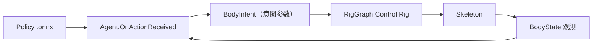

# 06｜学习与训练：ML-Agents 2

> 技术基线：`com.unity.ml-agents` **2.0.2**（ML-Agents Toolkit 2.x）+ `com.unity.barracuda` 3.0.0（端上推理）。
> 学习层只负责**运动策略**，不负责 Skill 语义、Belief 与 LLM 推理。

---

## 1. 为什么需要学习层

程序化控制的优点是可控、可解释、可调试；缺点是难写"自然的全身协调"（步态、平衡、接触丰富的手部操作）。

分工：

| 层 | 实现方式 | 理由 |
| --- | --- | --- |
| 注视 / 伸手 / 抓取 | 程序化（RigGraph IK + 有限状态机） | 精度可保证，失败码可解释 |
| 步态 / 平衡 / 整体姿态 | 学习（ML-Agents 2 PPO） | 手工调参成本高于训练成本 |
| 任务序列 / 目标选择 | 规则 + LLM | 需要可审计、可解释 |

**关键约束：策略输出的必须是"意图参数"，不是关节角。** 这样策略才可以被 Skill 调用、被 Verifier 检查、被遥测记录、被替换。

---

## 2. 技术栈与版本约束

| 项 | 取值 | 说明 |
| --- | --- | --- |
| Unity 包 | `com.unity.ml-agents` 2.0.2 | 只做场景插桩 + 端上推理接入 |
| 推理后端 | `com.unity.barracuda` 3.0.0 | 端上执行 `.onnx` 模型 |
| 训练端 | Python 包 `mlagents`（0.28.x 系列） + PyTorch | 训练、超参、课程、TensorBoard |
| Python 版本 | 建议 3.8 / 3.9 | 该版本区间之外的 Python 不被 0.28.x 支持 |
| 训练平台 | Editor 或 Standalone（Mono） | **IL2CPP 不支持训练**；但 IL2CPP 构建可以做推理 |
| 编辑器 | 团结引擎 1.10（Unity 2022.3 LTS API） | 不要使用 Unity 6 专有 API |

训练与推理是两条独立路径：

```text
训练：Unity 场景（Agent） ←gRPC→ Python mlagents-learn（PPO/BC/SAC/GAIL） → .onnx
推理：.onnx 导入 Assets/Models → BehaviorParameters.Model → Barracuda 在端上执行
```

---

## 3. ML-Agents 2 的接口面

### 3.1 一个 Agent 的最小实现

> 下面是示意骨架：`RigMotorBridge` 是运动层对外的桥接类（见 `05` §5），
> 实际项目里需要补齐 `BodyState` 与 `SetLocomotionIntent` 这类运动意图接口。

```csharp
using Unity.MLAgents;
using Unity.MLAgents.Actuators;
using Unity.MLAgents.Sensors;
using UnityEngine;

public class LocomotionAgent : Agent
{
    [SerializeField] RigMotorBridge rig;
    [SerializeField] Transform target;

    public override void CollectObservations(VectorSensor sensor)
    {
        // 观测只放"身体语义状态"，不要塞 60 根骨骼的四元数
        sensor.AddObservation(transform.localPosition);
        sensor.AddObservation(transform.forward);
        sensor.AddObservation(rig.BodyState.Stability);
        sensor.AddObservation(rig.BodyState.LocomotionSpeed);
        sensor.AddObservation(target.localPosition - transform.localPosition);
    }

    public override void OnActionReceived(ActionBuffers actions)
    {
        var c = actions.ContinuousActions;
        // 动作 = 意图参数，不是关节角
        rig.SetLocomotionIntent(
            forward: c[0], lateral: c[1], turn: c[2],
            pelvisHeight: Mathf.Lerp(-0.05f, 0.05f, (c[3] + 1f) * 0.5f));

        AddReward(RewardFunction.Evaluate(this));
        if (EpisodeDone()) EndEpisode();
    }

    public override void Heuristic(in ActionBuffers actionsOut)
    {
        var c = actionsOut.ContinuousActions;
        c[0] = Input.GetAxis("Vertical");     // 未装 Input System 包，用传统 Input
        c[1] = Input.GetAxis("Horizontal");
        c[2] = Input.GetAxis("Mouse X");
        c[3] = 0f;
    }
}
```

要点：

- 观测方法签名是 `CollectObservations(VectorSensor sensor)`（ML-Agents 2 起）；
- 动作处理是 `OnActionReceived(ActionBuffers actions)`；
- 手动测试用 `Heuristic(in ActionBuffers actionsOut)`；
- 离散掩码用 `WriteDiscreteActionMask(IDiscreteActionMask actionMask)`；
- 回合控制：`EndEpisode()` / `RequestDecision()` / `RequestAction()`；
- 奖励：`AddReward(float)` / `SetReward(float)`。

### 3.2 组件与能力

| 组件 / 类型 | 作用 |
| --- | --- |
| `Agent` | 观测、动作、奖励、回合 |
| `BehaviorParameters` | Behavior Name、观测尺寸、连续/离散分支、Model（`.onnx`）、Inference Device、Behavior Type |
| `DecisionRequester` | 决策周期（`DecisionPeriod`）、是否请求动作 |
| `SensorComponent` 子类 | `VectorSensor`、`CameraSensorComponent`、`RenderTextureSensorComponent`、`RayPerceptionSensorComponent3D`、`BufferSensorComponent` |
| `ActuatorComponent` / `IActuator` | 自定义执行器（把策略输出映射成结构化意图） |
| `SideChannel` | C# ↔ Python 额外通道（下发课程参数、上传统计） |
| Demonstrations / BC | 用人类演示做行为克隆的暖启动 |
| Environment Parameters | 课程学习：训练中动态调整难度参数 |

`BehaviorType` 三档决定运行形态：

```text
Default       训练时听 Python，无 Python 时用 Model 推理
InferenceOnly 只用 Model（发布形态）
HeuristicOnly 只用 Heuristic()（人工操作 / 回归测试）
```

---

## 4. 训练流程

```text
1. 场景：角色 + RigGraphManager + Agent + BehaviorParameters + DecisionRequester + 传感器
2. BehaviorParameters：Behavior Name = UnityChanLocomotion
                      Vector Observation Size 与 CollectObservations 对齐
                      Continuous Branches = 4（前进 / 侧移 / 转向 / 骨盆高度）
3. 写训练配置 YAML（超参、网络、奖励信号、课程）
4. mlagents-learn <config.yaml> --run-id=<id> 然后运行场景
5. TensorBoard 看 cumulative reward / episode length / loss
6. 训练收敛 → 在 behavior 的 results 目录取 .onnx → 导入 Assets/Models/
7. BehaviorParameters.Model 指向该模型，BehaviorType 切到 InferenceOnly 做发布
8. 回归：同一场景、固定随机种子、跑 N 局，记录成功率与时延
```

建议的观测/动作设计（本项目约定）：

```text
观测（BodyState + 少量几何）
  root 速度 / 朝向 / 高度 / 姿态
  pelvis 位置与速度
  每只脚的位置 / 接触标志
  目标点相对位置
  可选：少量射线（地面高度、前方障碍）

动作（意图参数）
  desired_velocity（前进 / 侧移）、desired_turn
  pelvis_height_offset、lean
  可选：foot_placement_hint

禁止
  直接输出每根骨骼四元数
  直接输出 IK 目标的世界坐标绝对位置（尺度/坐标敏感，难迁移）
```

---

## 5. 与 RigGraph 的接口



```text
策略 → 意图参数 → RigGraph 变量（IKEffectorWeight / SpeedScale / BalanceLean / FootTargetHint…）
     → 图内解算 → 骨架
```

- 训练时可以只开部分节点（例如关掉上半身 IK，专注步态）；
- 推理时把同一策略嵌进 Skill（例如 `WalkTo` 内部调用步态策略）；
- 策略与程序化控制可以混合：手部 IK 走程序化，步态走策略。

**不要**让策略绕过 RigGraph 直接写骨骼 Transform —— 那样会与动画、IK、Bake 全部打架。

---

## 6. 奖励设计原则

```text
1. 主奖励 = 任务完成（到达目标 / 保持平衡 N 秒 / 抓取成功）
2. 形状奖励 = 速度跟踪、朝向、能量惩罚、关节越限惩罚、脚滑惩罚
3. 惩罚必须"可解释且在 BodyState 里可见"，否则无法调试
4. 奖励尺度与决策周期绑定；改 DecisionPeriod 必须重看 reward
5. 课程学习：先静止站立 → 慢走 → 变速 → 转向 → 外部推力扰动
```

禁止：用"看起来不自然"这种不可测量的信号当奖励。

---

## 7. 与感知层、Skill 层的关系

| 关系 | 说明 |
| --- | --- |
| 与 Skill | Skill 可以调用策略；策略不能绕过 Skill 直接触发高层行为 |
| 与 Verifier | 策略不判定成功；成功仍由 Verifier（位置/接触/持续帧数）判定 |
| 与感知 | 视觉特征优先来自感知服务；避免让策略重复学习"看到什么" |
| 与遥测 | 每回合的成功率、时长、奖励分解都要落盘，作为 Procedural Memory 的输入 |
| 与 LLM | 完全无关：策略在 30～50 Hz 运行，LLM 是秒级模块 |

---

## 8. 评估与回归

```text
推荐做法：写一个 Python 侧评估脚本，用 mlagents_envs 的 UnityEnvironment
  - 固定随机种子与场景
  - 固定 BehaviorType = InferenceOnly
  - 跑 N 局（例如 200 局）
  - 输出：成功率、平均步数、能耗代理、失败码分布
```

Unity 侧同时落 JSONL 遥测（见 `03` §7），两侧数据合并成回归报告。

---

## 9. 里程碑

| 里程碑 | 内容 | 验收 |
| --- | --- | --- |
| L1 平地慢走 | 直线行走策略 | 10 局内 8 局走满 5 m，无摔倒 |
| L2 转向与变速 | 目标跟踪 | 目标随机变化时 80% 到达 |
| L3 平衡恢复 | 外部推力扰动下站立 | 施加 0.5 s 侧向力后 90% 不摔倒 |
| L4 混合控制 | 步态策略 + 程序化手部 IK | 边走边 Reach，Verifier 通过 |
| L5 课程与发布 | 课程学习 + InferenceOnly 构建 | 端上推理帧率与 Editor 差距 ≤ 20% |

---

## 10. 注意事项（踩坑清单）

```text
1. Python 版本过高（≥3.10）会导致 mlagents 安装失败 → 用 3.8/3.9 虚拟环境
2. Behavior Name 改动会让旧模型失配
3. Observations Size 与 CollectObservations 数量不一致是最常见的静默错误
4. DecisionPeriod 太小会显著拖慢训练；把物理与决策分开
5. 训练时不要开 IL2CPP；发布时才切 IL2CPP 做推理
6. Inference Device 选择要按端上实测（CPU 在低端机上常常比 GPU 快）
7. 不要在 Agent 里直接改骨骼 Transform，统一走 RigGraph（见 05）
8. 模型文件属于大二进制资产，不要提交到文档目录或让 Git 反复重编码
```
