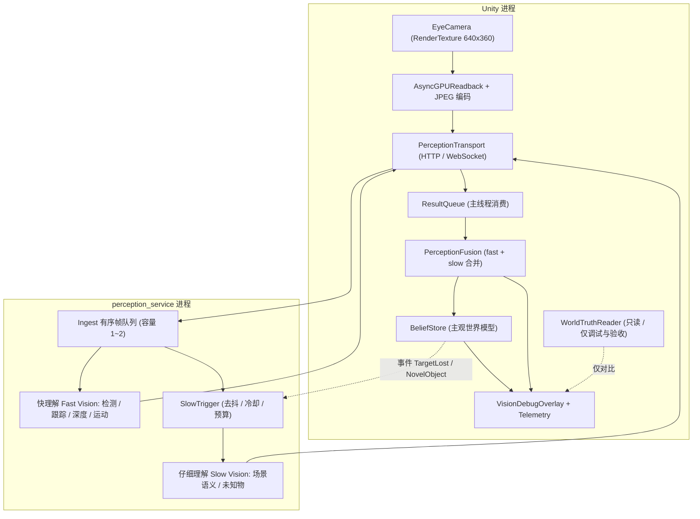
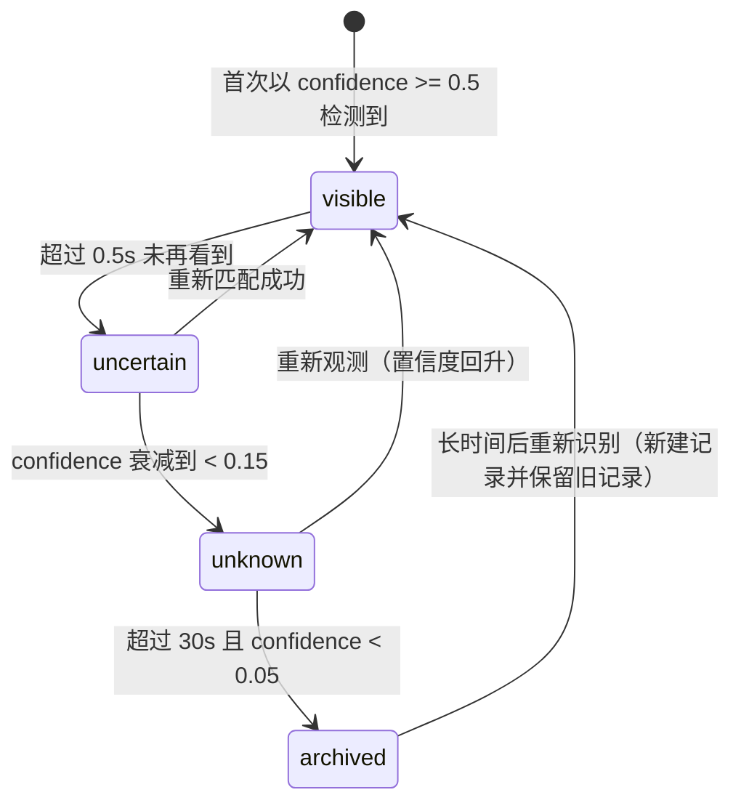
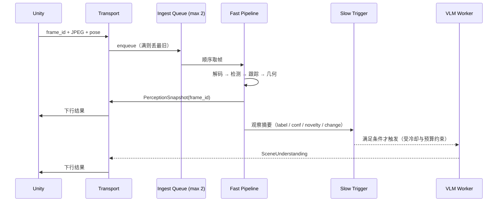

# 第一阶段落地方案：相机 → 视觉 → 理解闭环

> 适用阶段：Phase 1（`理论框架/07_路线图_阶段划分与验收.md` 的 `Vision → Belief`，本方案把它从"看见"推进到"两级理解 + 主观信念"）
> 覆盖范围：Eye Camera → 取帧 → 快理解 → 仔细理解 → PerceptionSnapshot → BeliefState
> 明确不覆盖：Goal、Planner、Skill、骨骼、IK、Locomotion、LLM 长任务推理
> 目标工程：`H:\Unity_Projects\embodied_metahuman`（团结引擎 Tuanjie 1.10.0 / Unity 2022.3.62t12 + URP 14.2.0-t1）

---

## 0. 这份方案是什么

阶段一要做的事只有一件：**让角色拥有可用的第一人称视觉理解，并把"看见的东西"变成一份可以错、可以不确定、会随时间衰减的主观信念。**

做完之后，系统能回答四个问题：

1. 我现在（这一帧画面里）看见了什么？
2. 它在屏幕哪里、大概多远、在不在动？
3. 我怎么理解这个场景（文字层面发生了什么）？
4. 我*认为*世界现在是什么样，以及我对这个判断有多确定？

阶段一做完之后，系统**仍然不会动**。角色的脖子、手、腿一根都不动。这是刻意的：架构的第一性原则是"Camera 不直接产生行为"，所以第一阶段把视觉链路做扎实，运动链路（LookAt / Reach / WalkTo）放到阶段二。

### 0.1 与理论框架的对应关系

本方案只做 Phase 1 的工程落地，所有设计依据来自 `Docs/理论框架`：

| 理论依据 | 本方案落点 |
| --- | --- |
| `00_总体架构.md`：分层、频率域、技术基线 | §2 总体架构、§6.1 采集参数 |
| `01_感知与信念.md`：两级理解、数据流、Belief 状态机 | §4 两级理解、§5 接口契约、§8 Belief |
| `01_感知与信念.md`：2D→3D 三档模式与重投影自检 | §6.3 |
| `01_感知与信念.md`：时序、失效判定、视觉事件 | §6.4、§5.4 |
| `08_接口契约与数据结构.md`：消息契约与命名规范 | §5 |
| `09_术语表与失败码总表.md`：失败码前缀规范 | §5.6、§9 |
| `04_Skill系统_可验证行为语言.md`：Verifier 思想 | §8（Belief 的判定同样由可验证量确认） |
| `07_路线图_阶段划分与验收.md`：Phase 1 边界 | §0、§12 |

### 0.2 三个关键取舍

| 取舍点 | 本方案选择 | 理由 |
| --- | --- | --- |
| Belief 放在哪 | **阶段一放 Unity（C#）**，Python 侧保持无状态理解服务 | 阶段一没有 Brain；Belief 放 Unity 才能被相机反馈直接消费。schema 与 `理论框架/01` 完全一致，阶段三可原样迁到 Python |
| 取帧频率 | **8～10 Hz 起步**（默认 10 Hz） | 与 Python 推理能力匹配，并额外定义"视觉事件驱动重看"（§6.5） |
| 3D 从哪来 | Mode A 只作自检基线，**默认 Mode B（Unity 深度）**，接口为 Mode C 预留 | 见 `理论框架/01` §5 |

### 0.3 三个决定方案形态的前置事实

1. **工程目前只有空场景骨架。** `Assets/` 下只有 `Scenes/SampleScene.scene` 与 URP 设置资产，还没有视觉、角色或 Skill 代码。所以阶段一是"从 0 建链路"，不需要兼容任何既有视觉代码。
2. **依赖情况（团结引擎 1.10 基线）。** 已装 URP 14.2.0-t1、**团结 Rig Graph `cn.tuanjie.riggraph` 1.0.0**、**ML-Agents 2 `com.unity.ml-agents` 2.0.2（+ Barracuda 3.0.0）**、Visual Scripting 1.9.5、Codely bridge 1.0.81；导航只有内置 `com.unity.modules.ai`（NavMesh），**未装** AI Navigation 包；**未装** Animation Rigging，也**未装** Sentis / AI Inference 包。因此阶段一默认"Python 侧推理"，Unity 侧只做采集 / 坐标重建 / 校验 / 可视化。若日后要把轻量模型搬进 Unity，是替换一个 `IVisionBackend` 实现（走 ML-Agents 2 的 Barracuda 通道），契约不动。
3. **单机单卡开发环境。** Unity 与 Python 服务在同一台机器，localhost 往返延迟可忽略。但仍按"跨进程"设计，这样日后拆机、拆显卡、把仔细理解甩到远端 API 时不用重写链路。

---

## 1. 目标与非目标

### 1.1 阶段一完成时，链路必须做到

| 编号 | 能力 | 可观测的判定方式 |
| --- | --- | --- |
| P1-1 | Eye Camera 以固定频率取帧，**不阻塞主线程、不阻塞渲染** | 连续运行 10 分钟渲染帧率无明显劣化；不存在同步 `ReadPixels` 调用 |
| P1-2 | 帧能跨进程送到 Python 做理解，Python 挂掉不影响 Unity | 停止 Python 进程后 Unity 继续运行，日志只有告警 |
| P1-3 | 快理解稳定输出检测 + 跟踪 + 深度/三维估计 | 目标进入视野 1 秒内产生 `track_id`；同一物体连续帧 `track_id` 不跳变 |
| P1-4 | 仔细理解按事件触发，输出结构化场景理解 | 新物体出现只触发一次；返回可解析 JSON 且带 `uncertainties` |
| P1-5 | 两级理解合并成 `PerceptionSnapshot` | 快几何字段永不被慢语义字段覆盖（有测试用例） |
| P1-6 | Belief 维护主观世界模型 | 目标离开视野后 `visible → uncertain → unknown`，置信度按时间衰减，而不是立即删除 |
| P1-7 | 结果带时间戳与相机姿态，可判定陈旧 | 相机大幅转动后旧结果被丢弃或降权（有测试用例） |
| P1-8 | 全链路可观测 | Debug 面板 + JSONL 遥测，能区分"没看见 / 看见但没理解对 / 结果太旧" |

### 1.2 明确不做（Non-goals）

- 不做 LookAt / 转头 / 注视闭环（阶段二）。阶段一只提供它需要的三个接口（§12.1）。
- 不做 Skill、Scheduler、资源锁、BodyIntent、IK、Grasp、NavMesh。
- 不把 VLM/LLM 放进实时链路。快理解路径里**一个 token 都不能出现**。
- 不做语音 / 文字命令理解（属于 Brain 层）。
- 不做长期记忆系统，只在仔细理解产出高价值结论时写入一个**缓冲队列**，真正的 Memory 在阶段三落地。
- 不做多相机、多角色、多视角融合。
- 不做 on-device 推理（不装 AI Inference 包），除非阶段一验收时性能不达标。
- 不做"真实人眼级理解"。阶段一的目标是**坐标链、时序、契约、降级**四件事正确。

### 1.3 贯穿全链路的原则

这七条来自三版文档的共同要求，是本文所有取舍的裁判：

1. **Camera ≠ 视觉。** 相机只产生像素，视觉系统才产生"对象"。
2. **视觉 ≠ 理解。** 检测框不等于"我知道那是什么、在干嘛"。
3. **理解 ≠ 事实。** 理解是带置信度的假设，写在 Belief 里，允许错。
4. **Perception 是"这一帧看见了什么"，Belief 是"我认为世界是什么样"。** 二者必须是两个数据结构、两次写入，不允许合并。
5. **Unity 主线程永不等待 Python。** 没有同步 await，没有阻塞读回。
6. **新鲜度 > 完整性。** 队列满时丢最旧帧，保留最新帧。
7. **一切跨进程消息结构化并带 `schema_version`**；成功由可验证量判定，不由"看起来对"判定。

---

## 2. 总体架构



### 2.1 分层职责与频率域

| 层 | 位置 | 职责 | 频率 | 超时预算 |
| --- | --- | --- | --- | --- |
| 采集层 Sensor | Unity | 取帧、编码、打包姿态与内参、入队 | 8～10 Hz（可配） | 单帧回读 ≤ 33 ms |
| 传输层 Transport | 双方 | 帧上行、快照下行、背压、重连 | 每帧 | 连接建立 ≤ 1 s |
| 快理解 Fast | Python | 检测、跟踪、深度→三维、运动、基础空间关系 | 5～15 Hz | p95 ≤ 120 ms |
| 仔细理解 Slow | Python | 场景语义、未知物解释、异常分析 | 事件触发 | p95 ≤ 6 s（超时即放弃） |
| 融合层 Fusion | Unity | 合并两级理解，产出唯一快照 | 随结果 / 10 Hz | — |
| 信念层 Belief | Unity | 匹配、更新、衰减、可见性状态机、发事件 | 10 Hz | — |
| 真值层 WorldTruth | Unity | **只读**，仅用于 Debug 面板与验收对比 | 按需 | — |

时钟域必须显式区分，这是阶段一最容易出错的地方：

```text
渲染            60 Hz
物理            50 Hz（本阶段用不到）
视觉采集         8 ~ 10 Hz
快理解           5 ~ 15 Hz
融合 / 信念      10 Hz
仔细理解         事件触发（秒级）
Debug UI         跟渲染帧
```

### 2.2 进程拓扑与启动顺序

```text
1. 启动 perception_service（Fast 常驻，Slow 按需加载模型）
2. perception_service 打印 {"event":"ready","fast_model":"...","slow_backend":"...","schema_version":"1.0"}
3. 启动 Unity；EyeCameraSensor 在 Start 里尝试连接，失败进入"离线模式"（只取帧、只画本地调试、不发送）
4. 连接恢复时自动重连（退避 1s → 2s → 5s 封顶），不需要重启 Unity
```

**为什么规定顺序：** 跟踪器是有状态的（见 §3 决策 4）。如果 Unity 先跑、Python 后起，`track_id` 会从 1 重新开始，Belief 中已有的 `belief_id` 关联会错乱。所以：**Fast 服务必须先起；或 Unity 检测到服务是新会话时，清空会话内的 track 关联（保留物体本身，只重置 `active_track_id`）。**

---

## 3. 关键设计决策与取舍

| # | 决策 | 理由 | 被否决的替代 |
| --- | --- | --- | --- |
| 1 | 取帧用 `RenderTexture` + `AsyncGPUReadback` | GPU→CPU 异步，不同步等待；主线程不阻塞 | `ReadPixels()`（同步，卡主线程）；`ScreenCapture.CaptureScreenshotAsTexture()`（同步且分配大） |
| 2 | 传 JPEG（quality 70～85），不传原始 RGBA，不 base64 | 640×360 RGBA ≈ 0.88 MiB/帧，10 Hz ≈ 8.8 MiB/s；JPEG 后通常降一个量级；base64 再涨 33% 且多一次拷贝 | 原始 RGBA 直传（带宽浪费）；JSON 内嵌 base64（体积与拷贝双输） |
| 3 | 传输先 HTTP multipart，再上 WebSocket 二进制 | HTTP 容易用 curl/Postman 验证链路，第一周即可跑通；WebSocket 用于稳定帧率与常驻会话 | 一上来就 WebSocket（调试成本高）；gRPC（生态重，Windows 上无收益） |
| 4 | **跟踪器常驻，服务因此有状态，所以需要会话** | YOLO track / ByteTrack 的 `track_id` 依赖跨帧持久状态。逐帧无状态 HTTP 请求会让每个 `track_id` 每帧重生，"追踪"名存实亡。这是选择 WebSocket 的**真正原因**，不是"性能更好" | 每帧独立检测 + Unity 侧自己最近邻匹配（可行，但把跟踪逻辑搬到 C# 且精度更差）；每帧新 ID（已无法指代对象） |
| 5 | 快 / 仔细两级分频，绝不把 60 FPS 画面喂 VLM | VLM 单次秒级且成本高；画面质量提升远比频率提升重要 | 每 N 帧送 VLM（成本失控）；只用 VLM 不用检测（拿不到稳定几何与 ID） |
| 6 | 三维默认 Mode B（Unity 深度），Mode A 只作自检，接口为 Mode C 预留 | Mode B 有真实深度传感器语义，误差可控；Mode A 是"上帝辅助"，只能验证坐标链；Mode C 是研究终点 | 直接上 Mode C（单目深度误差大，阶段一会淹在调参里）；只用 Mode A（永不到达可迁移形态） |
| 7 | 阶段一 Belief 放 Unity（C#），Python 保持无状态 | 阶段一没有 Brain；Belief 放 Unity 才能被相机反馈直接消费。schema 与 `理论框架/01` 一致，阶段三可平移 | 阶段一就把 Belief 放 Python（多一次往返，且阶段一并无收益） |
| 8 | `track_id` 与 Unity `GameObject` / `InstanceID` 解耦 | 视觉身份由视觉系统定义；真值映射只在 debug / Verifier 里做。防止"大脑偷读场景" | 直接返回 Unity 实例 ID（视觉失去独立性，Strict Vision 无法验证） |
| 9 | 仔细理解结果只作补充，不覆盖快理解的几何字段 | VLM 出的位置是粗粒度语言描述，用它覆盖 `world_position` 会引入幻觉位移 | 让 VLM 直接给坐标（幻觉 + 无精度） |
| 10 | 失败必须结构化（前缀码），不用 `true/false` | 上层才能做确定性恢复；遥测才能统计 | 布尔 + 自由文本 |

---

## 4. 两级理解的定义

### 4.1 快理解（Fast Vision）——"这一帧有什么，在哪里"

**回答层次：** 几何与身份。**输出形态：** 结构化、可逐帧比较、可被程序直接消费。

| 能力 | 实现要点 | 输出字段 |
| --- | --- | --- |
| 检测 Detection | 单阶段检测器（YOLO 系），输入 640，`conf ≥ 0.35`，类别白名单 + `other` 兜底 | `label` `confidence` `bbox_xyxy` |
| 跟踪 Tracking | 常驻跟踪器（ByteTrack / BoT-SORT），要求顺序送帧、`persist=True` | `track_id` `track_age_s` `frame_gap` |
| 深度 / 三维 | Mode B：ROI 稳健深度 + 内参反投影；Mode A：射线求交 | `depth_m` `world_position` `position_confidence` |
| 运动 Motion | bbox 中心位移 + 深度变化 + 相机自身运动补偿 | `moving` `velocity_hint` |
| 空间关系 Spatial | 归一化 uv 上的上下左右 / 前后 / 包含（够用即可） | `relations[]` |
| 视觉事件 | 新 track、track 丢失、画面突变 | `vision_events[]` |

**时延预算（端到端，同机 localhost）：**

```text
回读 5~20 ms + 编码 3~8 ms + 传输 < 2 ms + 推理 20~60 ms + 组装回传 < 2 ms
→ 中位数 ≈ 50 ms，p95 ≤ 120 ms（超过 120 ms 视为掉出实时域，结果标 stale）
```

**降级策略（必须实现，否则一条链路坏了整条体验就废）：**

| 故障 | 行为 |
| --- | --- |
| 模型未就绪 / 加载失败 | 返回 `PERCEPTION_MODEL_UNAVAILABLE`，Unity 保留上一次快照并标 `stale=true` |
| 单帧推理超时 | 丢弃该帧，不重试（重试只会加剧积压） |
| 连续 N 帧（默认 10）超时 | 发 `PERCEPTION_DEGRADED` 事件，Debug 面板转黄，采集频率自动降到 5 Hz |
| 检测置信度整体偏低 | 继续工作，同时压低 `position_confidence`，并向仔细理解通路投递"低置信度"触发信号 |

### 4.2 仔细理解（Slow Vision / VLM）——"这里发生了什么"

**回答层次：** 语义与解释。**输出形态：** 低频、语言描述 + 结构化假设 + 显式不确定性。

**触发条件（满足任一即触发，但受预算与冷却约束）：**

| 触发信号 | 判定方式 | 优先级 |
| --- | --- | --- |
| 出现未知物体 | 快理解 `label == "other"`，或 `track_id` 与所有 belief 匹配失败且持续超过 1.0 s | 高 |
| 第一次进入新区域 | 相机世界位置进入此前未记录的空间格（网格 2 m） | 中 |
| 场景大面积变化 | 相邻关键帧的检测集合变化率超阈值，或画面直方图距离突增 | 中 |
| 快理解长期低置信度 | 同一 track 连续 1.5 s `confidence < 0.5` | 中 |
| 上层 / 人类显式请求 | `slow.request` 消息（阶段二 LookAt / Inspect 会用它） | 最高 |
| 快理解连续失败 | 连续 3 次 `PERCEPTION_*` 错误 | 低 |

**预算与冷却（必须硬编码，否则会刷爆模型和日志）：**

```text
同一条触发信号冷却            ≥ 10 s
同一区域内未知物触发           ≥ 20 s
全局频率上限                   ≤ 6 次 / 分钟
单次超时                       6 s（超时即放弃本次，不影响快理解）
连续失败熔断                   3 次失败 → 暂停 5 分钟
```

**输入构造（关键：不是把整帧丢过去）：**

```text
输入 = 3~6 张关键帧（JPEG，长边 ≤ 960）
     + 每帧对应的检测结果（label / track_id / bbox / confidence）
     + 相机位姿（可换算成"角色面向 / 大致方位"的自然语言）
     + 可选：ROI 裁剪（当触发原因是某个具体未知物时，裁该物体周围区域）

关键帧选取规则：
  1) 最新帧（必须）
  2) 触发信号出现前的最后一帧（用于判断"新出现"）
  3) 目标 confidence 最高的帧
  4) 若触发原因是场景变化，取变化前后各一帧
  5) 不足 3 帧就用现有帧，不补造
```

**输出 schema：** 见 §5.3。

**抑制幻觉的三条硬规则：**

1. 只描述画面中**有像素证据**的内容；任何推断必须落在 `object_hypotheses` 而不是 `scene_summary`。
2. 不确定的东西必须写进 `uncertainties`，不允许用模糊措辞掩盖。
3. **不允许输出坐标数字。** 几何一律由快理解提供；确需方位时只允许粗粒度方位词（左前 / 右侧 / 远处）并写在 `relations` 里。

### 4.3 两级如何协作

| 情形 | 快理解 | 仔细理解 | 合并后对外 |
| --- | --- | --- | --- |
| 常规观察 | 正常输出 | 不触发 | 只有几何快照，`scene_summary = null` |
| 未知物体出现 | 输出 `other` + 位置 | 触发一次，解释"这可能是…" | 几何用 fast，语义用 slow，语义带 `source="vlm"` |
| 低置信度 | 输出低 `confidence` | 触发一次，尝试用上下文解释 | 快照保留低置信度，不因 slow 描述而抬高 |
| 场景突变 | 输出变化事件 | 触发一次，解释"桌面发生了什么" | 同上 |
| 显式请求 | 照常 | 立即触发，可覆盖冷却（但受全局频率上限约束） | 同上 |
| 仔细理解超时 / 失败 | 照常 | 放弃，记 `SLOW_*` 失败码 | 完全不阻塞，快照照常产出 |

**合并铁律：** 冲突时按字段归属决定，不按时间新旧决定。

| 字段 | 归属 | 仔细理解能否写 |
| --- | --- | --- |
| `bbox` `center_uv` `depth_m` `world_position` `moving` `track_id` | Fast（几何 / 身份） | **不能** |
| `label` | Fast 优先 | 只能写 `label_hint`；且仅在原 `confidence < 0.6` 时允许覆盖 |
| `scene_summary` `notable_events` `uncertainties` | Slow 独占 | 只有它能写 |
| `object_hypotheses` `relations` | Slow 追加 | 追加，不删除 fast 结论 |

---

## 5. 接口契约（阶段一的核心交付物）

### 5.1 FrameEnvelope（Unity → Python）

HTTP MVP 形态：`multipart/form-data`，`metadata` 部分是 JSON，`image` 部分是 JPEG 二进制。
WebSocket 形态：一条 JSON 文本消息（metadata）紧跟一条二进制消息（JPEG），`frame_id` 对齐。

```json
{
  "schema_version": "1.0",
  "frame_id": 18322,
  "capture_ts_ms": 1789891200123,
  "session_id": "sess_7f3a",
  "camera": {
    "width": 640,
    "height": 360,
    "fov_y_deg": 65.0,
    "near": 0.15,
    "far": 45.0,
    "position": [1.20, 1.62, 3.40],
    "rotation_xyzw": [0.0, 0.0, 0.0, 1.0],
    "unity_to_cv": true
  },
  "request": {
    "fast": true,
    "slow": false,
    "slow_reason": null,
    "roi": null
  }
}
```

| 字段 | 语义 | 约束 |
| --- | --- | --- |
| `frame_id` | 单调递增，会话内唯一 | 结果必须原样带回 |
| `capture_ts_ms` | **取帧时刻**（epoch ms），唯一权威时间 | 所有时延计算都以它为零点 |
| `camera.position` / `rotation_xyzw` | 该帧对应的相机位姿（世界系，米 / 四元数） | 用于结果失效判定 |
| `camera.fov_y_deg` | 垂直视场角 | 与分辨率一起构成内参 |
| `camera.unity_to_cv` | 是否已把 `v` 轴翻成左上原点 | 见 §6.3.4 的坐标系约定 |
| `request.slow` | 本帧是否请求仔细理解 | 由 SlowTrigger 决定，不由 Unity 猜 |

### 5.2 PerceptionSnapshot（Fast → Unity）

```json
{
  "schema_version": "1.0",
  "session_id": "sess_7f3a",
  "source_frame_id": 18322,
  "capture_ts_ms": 1789891200123,
  "result_ts_ms": 1789891200171,
  "infer_ms": 44,
  "camera_pose_at_capture": {
    "position": [1.20, 1.62, 3.40],
    "rotation_xyzw": [0.0, 0.0, 0.0, 1.0]
  },
  "objects": [
    {
      "track_id": 12,
      "label": "cup",
      "label_source": "fast",
      "confidence": 0.94,
      "bbox_xyxy": [381, 122, 447, 238],
      "center_uv": [0.647, 0.500],
      "bbox_area_ratio": 0.028,
      "depth_m": 1.83,
      "depth_source": "unity_depth",
      "world_position": [3.20, 0.82, 1.40],
      "position_confidence": 0.86,
      "moving": false,
      "track_age_s": 4.2,
      "visibility": "visible"
    }
  ],
  "scene": {
    "novelty": 0.18,
    "major_change": false,
    "unknown_object_count": 0
  },
  "vision_events": [
    { "type": "TRACK_APPEARED", "track_id": 12, "ts_ms": 1789891200170 }
  ],
  "warnings": []
}
```

**两个置信度必须分开（实测非常重要）：**

| 字段 | 含义 | 典型来源 | 用途 |
| --- | --- | --- | --- |
| `confidence` | "这确实是个杯子" | 检测器 | 决定是否值得写 Belief、是否触发仔细理解 |
| `position_confidence` | "它确实在这个三维位置" | 深度质量 + bbox 面积 + 重投影误差 | 决定能否支撑阶段二的 Reach |

**其它字段规则：**

- `center_uv` 用 0～1 归一化，避免分辨率耦合。
- `world_position` 允许为 `null`（估计失败就是失败，不编造）。
- `bbox_area_ratio` = bbox 面积 / 画面面积，是小目标保护与深度可信度的重要输入。
- Strict Vision 下**绝不返回** Unity 实例 ID。
- `depth_source ∈ {raycast_oracle, unity_depth, mono_depth, none}`，让遥测能按来源分组统计误差。

### 5.3 SceneUnderstanding（Slow → Unity）

```json
{
  "schema_version": "1.0",
  "session_id": "sess_7f3a",
  "request_id": "slow_0091",
  "trigger": "unknown_object",
  "source_frame_ids": [18322, 18310, 18297],
  "result_ts_ms": 1789891204801,
  "scene_summary": "桌面上有一个红色杯子，杯子旁边有一本书。",
  "notable_events": ["桌面出现了新物体"],
  "object_hypotheses": [
    {
      "track_id": 17,
      "hypothesis": "可能是一个外卖杯",
      "confidence": 0.55,
      "evidence": "圆柱形，白色杯身，位于桌面右侧"
    }
  ],
  "relations": [
    { "subject_track_id": 17, "relation": "ON_TOP_OF", "object_track_id": 8 }
  ],
  "uncertainties": ["无法确认杯子是否装有液体", "右侧物体被部分遮挡，无法确认类别"]
}
```

### 5.4 视觉事件（快照之外，用于驱动 Runtime）

| 事件 | 触发条件 | 对下游的意义（阶段二 / 三） |
| --- | --- | --- |
| `PERCEPTION_UPDATED` | 每份快照进入融合层 | 状态刷新心跳（低频，不代表要决策） |
| `TRACK_APPEARED` | 新 `track_id` 出现 | 可能触发好奇 → 新 Goal |
| `TARGET_LOST` | 某 `track_id` 连续 2.0 s 未出现 | Skill 失败码 `TARGET_LOST` |
| `TARGET_REACQUIRED` | 消失后以高置信度重现并匹配成功 | 恢复被打断的 Skill |
| `NOVEL_OBJECT` | `label == "other"` 或无法匹配任何 belief | 触发仔细理解、触发好奇 |
| `SCENE_CHANGED` | `major_change == true` | 触发仔细理解，可能使旧 plan 失效 |
| `PERCEPTION_DEGRADED` / `PERCEPTION_RECOVERED` | 连续超时 / 恢复 | 上层降级或恢复 |
| `SLOW_UNDERSTANDING_READY` | 仔细理解产出 | 追加语义、按重要性写记忆缓冲 |

### 5.5 BeliefState / BeliefObject

```json
{
  "schema_version": "1.0",
  "updated_ts_ms": 1789891205000,
  "objects": [
    {
      "belief_id": "visual_track_12",
      "label": "cup",
      "label_confidence": 0.94,
      "semantic": {
        "summary": "桌面上有一个红色杯子",
        "source": "vlm",
        "updated_ts_ms": 1789891204801,
        "confidence": 0.7
      },
      "last_seen_ts_ms": 1789891200123,
      "last_position": [3.20, 0.82, 1.40],
      "position_confidence": 0.86,
      "visibility": "visible",
      "active_track_id": 12,
      "properties": { "color": "red" },
      "uncertainties": ["是否装有液体"]
    }
  ],
  "unmatched_tracks": [17]
}
```

**可见性状态机（这是 Belief 与"最后一帧缓存"的本质区别）：**



**衰减公式（确定性、可调参、不交给 LLM 算数值）：**

```text
confidence(t) = confidence_at_last_seen * exp( -(t - last_seen_ts) / tau )
tau 默认 4000 ms（可配 2 ~ 8 s）

位置：无观测时保持 last_position；但一旦 enter unknown，
      该位置只能用于"去看看"（阶段二的 Search），不能直接用于 Reach。
```

**匹配规则（`track_id` ↔ `belief_id`）：**

```text
1. track_id 与某 belief 的 active_track_id 相同                     → 直接更新
2. 否则要求 (label 相同) 且 (预测位置距离 < gate) 且 (间隔 < 1.5s)    → 关联并更新 active_track_id
3. 否则                                                            → 新建 belief；label 未知时发 NOVEL_OBJECT
4. 位置跳变超过 gate（默认 1.5 m）且 bbox_area_ratio 未显著变化      → 视为可疑：
   不移动 belief，标记 visibility = uncertain，并写警告日志（防止视觉抖动把物体瞬移）
```

### 5.6 契约规则（所有消息通用）

1. 必带 `schema_version`；**未知字段忽略而不是报错**（保证前后端可独立升级）。
2. 坐标系：世界系为 Unity 左手 Y-up，单位米；屏幕 uv 归一化 0～1。
3. 时间统一 epoch 毫秒；`capture_ts_ms` 是唯一权威时间。
4. 凡是估计必须有置信度；不知道就写 `null` 或 `uncertain`，**不允许编造**。
5. 失败码前缀规范（完整表见 `理论框架/09_术语表与失败码总表.md`）：`PERCEPTION_` `TARGET_` `SLOW_` `TRANSPORT_` `TIMEOUT_`。
6. 请求 / 响应必须能配对：上行用 `frame_id`，仔细理解用 `request_id`。
7. 单条消息体量上限：metadata ≤ 256 KB，单帧 JPEG ≤ 400 KB（超限记 `TRANSPORT_OVERSIZE` 并丢弃）。

---

## 6. 快理解通路实现

### 6.1 Unity 采集侧

#### 6.1.1 场景层级（阶段一先简化，但留好位置）

```text
VirtualHuman.unity
├── VisionSystem                 (空物体：挂 PerceptionFusion / BeliefStore / VisionDebugOverlay)
├── EyeSensorRoot                (空物体：视觉传感器根)
│   └── EyeCamera                (Camera：targetTexture = EyeRT)
├── Directional Light
└── Plane

（阶段二接入角色后改为：）
UnityChan
└── Head
    └── EyeSensorRoot
        └── EyeCamera
```

`EyeSensorRoot` 的意义：以后调节视觉传感器不会破坏头部骨骼；阶段一先挂在空物体上，阶段二把整个子树挂到 `Head` 下即可，代码不用改。

#### 6.1.2 组件划分（单一职责，别写成一个 God Class）

| 组件 | 职责 | 明确不负责 |
| --- | --- | --- |
| `EyeCameraSensor` | 触发回读、编码、把帧交给 Transport | 不管频率、不管网络、不管重试 |
| `FrameCaptureScheduler` | 频率节流、配额分配、丢帧统计 | 不碰 GPU、不碰网络 |
| `PerceptionTransport` | 连接管理、上行 / 下行、重连、容量查询 | 不做视觉逻辑 |
| `PerceptionResultQueue` | 把后台回调收到的结果排队到主线程 | 不解析业务 |
| `PerceptionFusion` | 合并快 / 慢理解、去重、字段归属裁决 | 不持久化 |
| `BeliefStore` | 匹配、更新、衰减、发事件 | 不画 UI |
| `VisionDebugOverlay` | IMGUI / UI Toolkit 面板 + Game View 画框 | 不修改状态 |
| `VisionTelemetry` | JSONL 落盘、指标聚合 | 不参与控制 |

#### 6.1.3 默认参数

| 参数 | 默认值 | 说明 |
| --- | --- | --- |
| RenderTexture | 640×360，`R8G8B8A8_UNorm` | 起步值，先保证链路，再按需要提到 960×540 |
| 采集频率 | 10 Hz | 与 Python 推理能力匹配；`PERCEPTION_DEGRADED` 时自动降到 5 Hz |
| Camera FOV | 65°（垂直） | 决定内参；改动后必须重跑重投影自检 |
| Near / Far | 0.15 / 45 | 尽量贴合场景，避免深度精度浪费 |
| JPEG quality | 80 | 实测 70～85 区间够用 |
| Unity 渲染 | 60 FPS | 与取帧解耦 |
| 上行队列 | 2 帧 | 满则丢最旧 |
| 下行结果队列 | 4 条 | 满则丢最旧 |
| 结果过期阈值 | 帧龄 > 500 ms，或落后 8 帧 | 超龄结果直接丢 |

#### 6.1.4 代码骨架（关键点都在注释里）

```csharp
// Assets/Scripts/Vision/FrameCaptureScheduler.cs
using UnityEngine;

namespace VirtualHuman.Vision
{
    /// 只做一件事：决定"这一帧要不要采"，并保证 frame_id 单调。
    public sealed class FrameCaptureScheduler : MonoBehaviour
    {
        [SerializeField] float captureHz = 10f;
        [SerializeField] int   maxInflightFrames = 2;

        float nextCaptureTime;
        long  frameId;
        int   inflight;

        public int   DroppedFrames { get; private set; }
        public float CurrentHz     => captureHz;

        public void SetCaptureHz(float hz) => captureHz = Mathf.Clamp(hz, 1f, 30f);

        /// 背压第一道闸：没有余量就根本不发起 GPU 回读。
        public bool TryBeginCapture(out long id, out double captureTime)
        {
            id = 0;
            captureTime = 0;

            if (inflight >= maxInflightFrames)
            {
                DroppedFrames++;   // 这是"我主动不采"，与"发出去被丢"分开统计
                return false;
            }
            if (Time.unscaledTimeAsDouble < nextCaptureTime) return false;

            nextCaptureTime = Time.unscaledTimeAsDouble + 1.0 / captureHz;
            id = ++frameId;
            captureTime = Time.unscaledTimeAsDouble;
            inflight++;
            return true;
        }

        public void EndCapture() => inflight = Mathf.Max(0, inflight - 1);
    }
}
```

```csharp
// Assets/Scripts/Vision/EyeCameraSensor.cs
using Unity.Collections;
using UnityEngine;
using UnityEngine.Rendering;

namespace VirtualHuman.Vision
{
    public sealed class EyeCameraSensor : MonoBehaviour
    {
        [SerializeField] Camera                eyeCamera;
        [SerializeField] RenderTexture         target;      // R8G8B8A8_UNorm, 640x360
        [SerializeField] FrameCaptureScheduler scheduler;
        [SerializeField] PerceptionTransport   transport;
        [SerializeField, Range(50, 95)] int    jpegQuality = 80;

        void Awake()
        {
            eyeCamera.targetTexture = target;
        }

        void Update()
        {
            if (!scheduler.TryBeginCapture(out long id, out double captureTime)) return;

            CameraPose pose = CameraPose.From(eyeCamera, captureTime);

            // 显式指定目标格式，避免 RT 的 GraphicsFormat 与编码器要求不一致。
            AsyncGPUReadback.Request(
                target, 0, TextureFormat.RGBA32,
                request =>
                {
                    scheduler.EndCapture();

                    if (request.hasError)
                    {
                        transport.ReportCaptureError(id, "TRANSPORT_READBACK_ERROR");
                        return;
                    }

                    NativeArray<byte> rgba = request.GetData<byte>();
                    using NativeArray<byte> jpg = ImageConversion.EncodeNativeArrayToJPG(
                        rgba,
                        GraphicsFormat.R8G8B8A8_UNorm,
                        (uint)target.width,
                        (uint)target.height,
                        0,
                        jpegQuality);

                    // callback 结束后 request 数据不再有效，必须先拷贝再入队。
                    transport.EnqueueFrame(id, captureTime, pose, jpg.ToArray());
                });
        }
    }
}
```

```csharp
// Assets/Scripts/Vision/PerceptionTransport.cs（要点，不含实现）
namespace VirtualHuman.Vision
{
    public interface IPerceptionTransport
    {
        bool HasCapacity(long frameId);
        void EnqueueFrame(long frameId, double captureTime, CameraPose pose, byte[] jpeg);
        void ReportCaptureError(long frameId, string code);
        bool TryDequeueResult(out string json);
    }
    // 实现要求：
    // 1) EnqueueFrame 只入队，绝不同步等待响应
    // 2) 发送协程从队列取"最新"帧；队列满丢最旧
    // 3) 失败只记日志并计数，不抛异常、不阻塞主线程
    // 4) 收到结果只入 resultQueue，JSON 解析放在主线程
}
```

#### 6.1.5 RenderTexture 配置注意事项

- `GraphicsFormat` 用 `R8G8B8A8_UNorm`，sRGB 开关要与项目色彩空间一致（URP Linear 下不一致会导致颜色偏差）。
- RT 的 `depthBuffer` 设为 24 或 16（Mode B 深度读回时可能需要）。
- 给 `EyeCamera` 设了 `targetTexture` 之后它不再渲染到屏幕；阶段一若要观察画面，另建一个 Display Camera，或把 `EyeRT` 显示在 Debug Overlay 上。

### 6.2 Python 快理解服务

#### 6.2.1 目录结构

```text
python/perception_service/
├── app.py                    # 进程入口：读配置、装配管道、启动 HTTP / WS
├── config.py                 # 所有可调参数集中在此（与 §6.1.3 对齐）
├── schema.py                 # pydantic 模型：FrameEnvelope / PerceptionSnapshot / SceneUnderstanding
├── transport/
│   ├── http_server.py        # MVP: POST /perception/frame (multipart)
│   └── ws_server.py          # 实时: /ws/perception (JSON + binary)
├── fast/
│   ├── detector.py           # 检测（模型封装，可替换）
│   ├── tracker.py            # 常驻跟踪器，维护 track_id 生命周期
│   └── geometry.py           # 深度→三维、内参反投影、运动估计
├── slow/
│   ├── trigger.py            # 触发器 + 冷却 + 预算 + 熔断
│   ├── keyframe.py           # 关键帧选取与裁剪
│   └── vlm.py                # VLM 后端（本地或 API），强制 JSON 输出
├── core/
│   ├── pipeline.py           # 有序帧队列 → 检测 → 组装快照
│   ├── backpressure.py       # 队列容量与丢弃策略
│   └── telemetry.py          # 指标聚合，JSONL 输出
└── requirements.txt
```

#### 6.2.2 处理管道



**顺序性要求（跟踪能否工作的关键）：**

```text
1. 快理解必须单线程顺序消费，不允许并发处理多帧（会破坏跟踪器的帧序假设）
2. 队列容量 1~2，满则丢最旧，并把丢弃记入遥测
3. 丢帧后必须通知跟踪器"发生了跳帧"（本帧与上帧的间隔），
   跟踪器据此放宽 gate 并降低该 track 的置信度，而不是假装时间连续
4. 仔细理解独立 worker，与快理解完全解耦，超时不影响快路径
```

#### 6.2.3 检测 + 跟踪（骨架）

```python
# python/perception_service/fast/tracker.py（要点）
from ultralytics import YOLO


class FastTracker:
    """常驻跟踪器：整个服务生命周期内只有一个实例。"""

    def __init__(self, model_path: str, conf: float = 0.35, iou: float = 0.5):
        self.model = YOLO(model_path)
        self.conf, self.iou = conf, iou

    def process(self, frame_bgr, frame_gap: int = 1):
        # persist=True 让 track_id 跨帧稳定；顺序调用保证帧序假设成立
        results = self.model.track(
            frame_bgr,
            persist=True,
            tracker="bytetrack.yaml",
            conf=self.conf,
            iou=self.iou,
            imgsz=640,
            verbose=False,
        )
        r = results[0]
        boxes = r.boxes
        if boxes is None or boxes.id is None:
            return []

        out = []
        for xyxy, cls_id, conf, track_id in zip(
            boxes.xyxy.tolist(),
            boxes.cls.tolist(),
            boxes.conf.tolist(),
            boxes.id.tolist(),
        ):
            out.append(
                {
                    "track_id": int(track_id),
                    "label": r.names[int(cls_id)],
                    "confidence": float(conf),
                    "bbox_xyxy": [float(v) for v in xyxy],
                    "frame_gap": frame_gap,  # 让下游知道这个 track 经历了跳帧
                }
            )
        return out
```

模型文件通过配置项 `FAST_MODEL_PATH` 指定（`yolo11n` / `yolo11s` 级别的轻量权重即可），**不写死在代码里**，便于按算力替换。

#### 6.2.4 跟踪器为何必须常驻（落地时最容易踩的坑）

```text
错误做法：每个 HTTP 请求 new 一个模型实例，或调用时不传 persist
后果：  同一杯子在连续帧里得到不同 track_id（12 → 37 → 5 …）
        上层无法指代"同一个物体"，Belief 无法匹配，仔细理解会被"新物体"刷爆

正确做法：
  1) 进程启动时构建一次模型与跟踪器，常驻内存
  2) 每帧按 capture_ts_ms 顺序送入
  3) 会话开始时显式 reset，或用 session_id 区分，确保跨会话 ID 不串
  4) 服务重启后必须发 session_started 事件，Unity 侧据此重置 active_track_id 关联
```

#### 6.2.5 快理解的其它产物

| 产物 | 计算方式 |
| --- | --- |
| `novelty` | 归一化后的"新 track 比例 + 未知类别比例"，0～1 |
| `major_change` | 检测集合的 Jaccard 距离 > 0.5，或画面直方图距离超阈值 |
| `moving` | bbox 中心在 0.3 s 内位移 > 2% 画面宽度（已扣除相机自身运动） |
| `relations[]` | 归一化 uv 上的左右 / 上下 / 包含 / 最近邻，只出确定性结论 |

### 6.3 2D → 3D 三档模式

#### 6.3.1 Mode A：射线求交（仅作自检基线）

```csharp
public bool TryResolveByRaycast(Vector2 uv, out Vector3 worldPos)
{
    Ray ray = eyeCamera.ViewportPointToRay(new Vector3(uv.x, uv.y, 0f));
    if (Physics.Raycast(ray, out RaycastHit hit, 20f, interactableMask))
    {
        worldPos = hit.point;
        return true;
    }
    worldPos = default;
    return false;
}
```

用途与限制：验证坐标链是否正确、在阶段二早期提供"上帝辅助"目标；但 bbox 中心不一定落在目标实体上，且它不是真实视觉深度估计。**Mode A 的数值只能用于对比，不能作为阶段一验收中的精度指标。**

#### 6.3.2 Mode B：Unity 深度传感器（阶段一默认）

```text
1. Python 返回 center_uv + bbox
2. Unity 在 bbox 内缩 25% 的 ROI 上取深度值
3. 取 ROI 内有效深度的中位数（剔除 0 / 背景 / 远于 far*0.98 的值）
4. 用内参把 (u, v, depth) 反投影到相机空间，再变换到世界系
5. 顺带算重投影误差，作为 position_confidence 的输入
```

**为什么用 ROI 中位数而不是中心单点：** 中心点极易落在背景、桌面或物体边缘外，单点深度噪声大；ROI 中位数对遮挡与边缘更鲁棒。

#### 6.3.3 URP 下深度纹理的获取

```text
前置条件（URP 与内置管线的差异，必须确认）：
  - 在 URP Asset 上使能 Depth Texture（相机级 depthTextureMode 在 URP 下不完整生效）
  - Shader 侧可访问 _CameraDepthTexture（非线性 raw depth）与 _ZBufferParams

CPU 读回路径：
  1) 建一张同分辨率的 RenderTexture（RFloat 或 ARGB32 编码深度）
  2) 用一个只做"raw depth → 线性视深"的全屏 Blit 材质写入该 RT：
       float raw = SAMPLE_DEPTH_TEXTURE(_CameraDepthTexture, uv);
       float eye = 1.0 / (_ZBufferParams.z * raw + _ZBufferParams.w);   // 线性视深（米）
  3) 对该 RT 做 AsyncGPUReadback（同样异步，不阻塞主线程）
  4) 在 CPU 端按 ROI 取中位数

团结引擎 1.10 使用 URP 14.2（Unity 2022.3 分支），没有 Render Graph，上述 Blit + 读回路径可直接使用。
若深度纹理仍拿不到（未开 Depth Texture、后处理时机冲突、降级渲染路径差异）：
  退一步用"深度专用相机"（只渲染深度层 + depth-only 材质）自建深度 RT；
  或先切 Mode A 把链路跑通，再回来补深度（不要卡在这一步上）
```

#### 6.3.4 内参与坐标换算（连同坐标系约定一起定死）

```text
约定：
  - uv 归一化 0~1，v 从画面底部往上（Unity viewport 习惯）
  - 上行 metadata 里 unity_to_cv=true 表示"Python 侧已把检测框坐标翻成左上原点"；
    跨进程传递时一律使用左上原点，Unity 收到后翻回底部原点
  - 深度 d 定义为沿相机前方（相机空间 z）的距离，单位米

内参：
  aspect = W / H
  fy = (H / 2) / tan(fovY / 2)
  fx = fy

反投影（相机空间 → 世界系）：
  ndc_x = (2u - 1) * aspect * tan(fovY / 2) * d
  ndc_y = (2v - 1)          * tan(fovY / 2) * d
  camPoint  = (ndc_x, ndc_y, d)
  worldPos  = camPos + (camRot * camPoint)

等价像素形式（便于核对）：
  x_cam = (u - 0.5) * W / fx * d
  y_cam = (v - 0.5) * H / fy * d
```

```csharp
public static Vector3 Unproject(Vector2 uv, float depthM, CameraPose pose, float fovYDeg)
{
    float halfFov = fovYDeg * 0.5f * Mathf.Deg2Rad;
    float t       = Mathf.Tan(halfFov);
    float aspect  = (float)pose.Width / pose.Height;

    float x = (2f * uv.x - 1f) * aspect * t * depthM;
    float y = (2f * uv.y - 1f) * t * depthM;

    return pose.Position + pose.Rotation * new Vector3(x, y, depthM);
}
```

#### 6.3.5 重投影自检（阶段一最有价值的一项检查）

把估计出的 `world_position` 用同一套内参投影回屏幕，与原始 `center_uv` 比对：

```text
重投影误差_uv = |project(world_position) - center_uv|    （归一化坐标）

判定：
  ≤ 1%    优秀（说明内参、坐标系、深度三者自洽）
  ≤ 3%    可接受
  > 3%    视为坐标链有 bug —— 优先检查：
          v 轴方向 / fov 用的是垂直还是水平 / 深度是"沿视线的 z"还是"欧氏距离" /
          四元数左乘右乘

副产物：该误差直接喂给 position_confidence：
  position_confidence = clamp(det_conf * depth_quality * exp(-err / 0.03), 0, 1)
```

**这条检查在阶段一每天跑一次**，因为它是唯一能在没有运动层的情况下验证"三维视觉真的可用"的手段。

#### 6.3.6 Mode C 的预留

Mode C = 单目深度 + 跟踪 + 相机运动 → 估计三维。接入方式：`depth_source` 从 `unity_depth` 换成 `mono_depth`，`geometry.py` 里换一个 `IDepthProvider` 实现，**契约、快照字段、Belief 逻辑全部不动**。Mode C 下位置误差显著变大，因此上层必须依赖 `position_confidence` 与"注视 → 接近 → 重新观察 → 细化"的行为模式（阶段二）。

### 6.4 时序正确性与结果失效

```text
采样点：
  capture_ts_ms      取帧时刻（权威）
  infer_ms           Python 侧推理耗时
  result_ts_ms       结果产出时刻
  receive_ts         Unity 收到时刻（可算出端到端时延）

失效判定（满足任一即丢弃或降权）：
  A. frame 落后：current_frame_id - source_frame_id > 8        → 丢弃
  B. 帧龄过大：now - capture_ts_ms > 500 ms                     → 丢弃
  C. 相机已移动：|camPos_now - camPos_at_capture| > 0.30 m      → 丢弃
  D. 相机已转动：angle(camRot_now, camRot_at_capture) > 15°     → 丢弃
  E. 当前 Skill 目标已切换（阶段二生效）                          → 丢弃

降权（不丢弃但降低可信度）：
  位姿变化处于阈值的 50% ~ 100% 之间 → position_confidence *= 0.5
```

**"结果过旧"与"目标丢失"必须区分开：** 前者是我的信息过期了（不是世界变了），后者是世界可能变了。前者只丢弃结果，不产生 `TARGET_LOST`；后者才驱动 Belief 状态迁移。混在一起会让 Belief 频繁误报丢失。

### 6.5 视觉事件驱动的"重看"

阶段一不含运动，但视觉内部可以闭环：

```text
1. 某个 belief 处于 uncertain 且是当前 focus 对象
2. 请求一帧"高价值观察"：提高该帧 JPEG 质量（如 92）或对 ROI 做裁剪放大
3. 若连续 3 次仍无法确认 → 保持 uncertain，等阶段二的转向能力来救
   （这是合理的能力边界，不要硬撑）
```

---

## 7. 仔细理解通路实现

### 7.1 触发器实现要点

```python
# 触发判定的骨架
def should_trigger(obs, budget, state, now_ms):
    if state.human_requested:
        return "explicit_request"
    if not budget.allow(now_ms):
        return None                                    # 全局频率上限 / 熔断
    if obs.unknown_object_count > 0 and state.cooldown_ok("unknown", now_ms, 20_000):
        return "unknown_object"
    if obs.novelty > 0.6 and state.cooldown_ok("novelty", now_ms, 10_000):
        return "scene_novel"
    if obs.major_change and state.cooldown_ok("change", now_ms, 10_000):
        return "scene_changed"
    if state.low_conf_streak > 1.5 and state.cooldown_ok("lowconf", now_ms, 15_000):
        return "low_confidence"
    if state.fast_error_streak >= 3:
        return "fast_degraded"
    return None
```

### 7.2 关键帧与请求构造

```text
保留环形缓冲：最近 6 帧的 (frame_id, capture_ts, jpeg, 检测结果, 位姿)
触发时按 §4.2 的规则挑 3~6 帧
裁剪：若触发原因是具体未知物，把该物体 bbox 外扩 30% 后裁剪，长边重采样到 960
体积控制：单次请求总 JPEG ≤ 1.5 MB
```

### 7.3 后端选择与降级

| 后端 | 适用 | 超时 | 失败处理 |
| --- | --- | --- | --- |
| 本地小 VLM | 离线、隐私、无 API 成本 | 6 s | 超时即放弃本次，记 `SLOW_TIMEOUT` |
| 远端多模态 API | 需要更强理解 | 6 s（可配） | 网络错误重试 1 次，仍失败则放弃并计熔断 |
| 无后端（阶段一初始状态） | 只跑快理解 | — | `slow_backend = "none"`，触发器直接返回 None，链路其余部分不受影响 |

**"无后端也能跑"是硬要求**：阶段一第一周就应该能在没有 VLM 的情况下完成 P1-1 到 P1-3 的全部验收。

### 7.4 提示词契约（要点，不是完整 prompt）

```text
system:
  你是虚拟角色的视觉理解模块。你只描述画面中确实存在的内容。
  规则：
    1) 不输出任何坐标、距离数字，几何信息由其他模块负责
    2) 无法确认的内容必须写进 uncertainties
    3) 只输出 JSON，不要输出解释性文字或 Markdown 代码块
    4) 若画面信息不足，把 scene_summary 写成"无法确定"并在 uncertainties 说明

user:
  [附 3~6 张关键帧]
  已知检测结果：<label / track_id / bbox / confidence 列表>
  相机大致方位：<方位描述>
  期望输出 JSON schema：
  { scene_summary, notable_events[], object_hypotheses[],
    relations[], uncertainties[] }
```

### 7.5 输出校验与落地

```text
1. JSON 解析失败 / schema 校验失败 → 降级为 fast-only，记 SLOW_BAD_OUTPUT（计入熔断）
2. 校验通过后：
   a. 写入对应 belief 的 semantic 字段（source="vlm"，带自己的 confidence）
   b. 发 SLOW_UNDERSTANDING_READY 事件
   c. 若 trigger ∈ {unknown_object, scene_changed} 且重要度较高，
      推入 memory 缓冲队列（阶段三消费）；阶段一只落 JSONL
3. 绝不修改：
   - belief 的 last_position / position_confidence
   - 快理解的 label（除非 fast 为 "other" 且 vlm confidence ≥ 0.6，此时写 label_hint）
```

---

## 8. Belief 层实现（阶段一的终点）

### 8.1 更新循环（10 Hz + 事件驱动）

```text
每 tick（10 Hz）：
  1. 拉取融合后的最新快照（同一 capture_ts 只处理一次）
  2. 对每个观测做匹配（§5.5 规则）→ 更新或新建 belief
  3. 对未被观测到的 belief 做时间衰减，并迁移 visibility
  4. 发事件：TRACK_APPEARED / TARGET_LOST / TARGET_REACQUIRED / NOVEL_OBJECT / SCENE_CHANGED
  5. 写遥测（正常每 1 s 一条，异常立即一条）
```

### 8.2 参数默认值
| 参数 | 默认 | 说明 |
| --- | --- | --- |
| `tau`（衰减时间常数） | 4000 ms | 2～8 s 可调；越小忘得越快 |
| `visible → uncertain` | 500 ms 未见 | 10 Hz 下约等于丢 2 帧 |
| `uncertain → unknown` | confidence < 0.15 | 约 2 个 tau |
| `unknown → archived` | 30 s 且 confidence < 0.05 | 归档而不是删除 |
| 匹配 gate | 1.5 m / 1.5 s | 同时要求 label 一致 |
| 位置跳变保护 | > 1.5 m 且面积比未显著变化 → 不移动，标 uncertain | 防抖 |

### 8.3 不该更新 Belief 的情况（写清楚，否则会写出一个"抖动放大器"）

```text
- confidence < 0.35 的检测：不新建 belief（只累加低置信度计数，供仔细理解触发用）
- 判定为 stale 的结果：完全不进入 Belief
- position_confidence < 0.2：更新 label 与 last_seen，但不动 last_position
- 单帧内的重复检测（IoU > 0.6）：只保留置信度最高的一个
- 仔细理解的语言描述：只能写 semantic 字段
```

### 8.4 与 WorldTruth 的对比（只用于调试与验收）

`WorldTruthReader` 只做一件事：在 Debug 面板里并排显示

```text
WorldTruth: cup_truth at (3.20, 0.82, 1.40)
Belief    : cup_12  visible at (3.18, 0.80, 1.42) conf 0.86
Δ         : 0.035 m   重投影误差 0.8%
```

这是 `理论框架/01` §7 那个关键实验（"偷偷把物体移走，但角色没看见移动过程"）的实现基础：真值变了，Belief 应保持旧位置并逐步降低置信度，直到重新观测。

---

## 9. 可观测性

### 9.1 Debug 面板（Game View + Scene）

```text
[链路]     EyeCam 60fps | Capture 10.0Hz | Sent 9.8/s | Dropped 3
           RTT p50 62ms p95 108ms | inflight 1/2 | State CONNECTED
[快理解]   frame_id 18322 | infer 44ms | objects 3 | unknown 1
           cup    track=12 conf=.94 uv(.65,.50) d=1.83m pos_conf=.86 err=0.8%
           table  track=8  conf=.88 uv(.41,.72) d=2.40m pos_conf=.79 err=1.4%
           other  track=17 conf=.52 uv(.78,.44) d=1.21m pos_conf=.41 err=2.9%
[仔细理解] last 12.4s ago (unknown_object) | ok 4 / fail 1 | next allowed in 7.6s
           summary: 桌面上有一个红色杯子，杯子旁边有一本书。
[Belief]   cup_12 visible conf .86 pos (3.20,0.82,1.40)
           door_3 unknown last_seen 42s ago (archived in 18s)
           unmatched_tracks: [17]
[事件]     PERCEPTION_UPDATED TRACK_APPEARED(17) NOVEL_OBJECT(17)
```

Scene 视图要画：bbox、`track_id`、目标中心点、深度重建点、重投影点（与中心点比对即可肉眼看出坐标链问题）、ROI 深度取样区域框。

### 9.2 遥测（JSONL，`Logs/perception/`）

| 指标 | 用途 |
| --- | --- |
| `capture_hz` / `sent_hz` / `dropped_frames` | 判断采集与背压 |
| `rtt_p50` / `rtt_p95` / `infer_ms` | 判断实时性是否达标 |
| `objects_count` / `unknown_count` / `avg_confidence` | 判断检测质量 |
| `track_churn`（每分钟新 track 数 / 平均存活 track 数） | 跟踪是否稳定；churn 高说明 ID 在跳 |
| `stale_ratio`（被丢弃结果 / 收到结果） | 时序是否健康 |
| `slow_trigger_count` / `slow_fail_count` / `slow_latency_p95` | 仔细理解的成本与稳定性 |
| `reproject_error_p50` / `p95` | 坐标链质量 |
| `belief_count` / `visible_ratio` | 主观世界模型规模与新鲜度 |

### 9.3 告警阈值（超阈值时面板变色 + 日志 WARN）

| 指标 | 阈值 |
| --- | --- |
| `stale_ratio` | > 10% 持续 30 s |
| `rtt_p95` | > 200 ms 持续 30 s |
| `track_churn` | > 2.0 /min |
| `reproject_error_p95` | > 3% |
| `slow_fail_count` | 连续 3 次 |

---

## 10. 验收标准（可量化）

### A. 图像链

| 项 | 方法 | 通过标准 |
| --- | --- | --- |
| A1 不卡主线程 | 连续运行 10 分钟，采样渲染帧耗时 | 无因取帧导致的单帧耗时 > 33 ms 尖峰；无同步 `ReadPixels` |
| A2 无泄漏 | 10 分钟后 Native / Managed 内存对比 | NativeArray 全部释放；托管内存无单调增长 |
| A3 Python 掉线不影响 Unity | 运行中杀进程 | Unity 无异常抛出，仅告警；渲染正常 |
| A4 自动重连 | 杀掉后 10 s 内重启服务 | 无需重启 Unity，30 s 内恢复 CONNECTED |
| A5 丢帧率 | 10 分钟统计 | `dropped / target < 5%` |

### B. 感知链

| 项 | 方法 | 通过标准 |
| --- | --- | --- |
| B1 检测可用 | 固定场景放 3 个已知物体 | 进入视野 1 s 内被检出，`confidence ≥ 0.6` |
| B2 跟踪稳定 | 物体静止 60 s | 同一物体 `track_id` 变化次数 = 0 |
| B3 遮挡恢复 | 物体被短暂遮挡 1 s | 恢复后 `track_id` 复用率 ≥ 80% |
| B4 未知物处理 | 放一个不在类别表里的物体 | 标 `other`，并触发且仅触发一次仔细理解 |
| B5 ID 解耦 | 检查快照内容 | 不含任何 Unity 实例 ID |

### C. 空间链

| 项 | 方法 | 通过标准 |
| --- | --- | --- |
| C1 坐标链自洽 | 重投影自检 | 误差 p95 ≤ 3%（优秀 ≤ 1%） |
| C2 深度精度 | 与真值对比（1 m / 2 m / 3 m） | 误差 ≤ 3 cm / 6 cm / 12 cm（**首轮跑完按实测校准**） |
| C3 小目标保护 | bbox 面积比 < 0.5% | `position_confidence < 0.4` |
| C4 模式对照 | Mode A 与 Mode B 同点对比 | 差异有记录、可解释，不要求数值一致 |
| C5 相机移动失效 | 快速转头 30° 后检查旧结果 | 旧结果被丢弃或 `position_confidence` 减半 |

### D. 理解闭环（两级协作）

| 项 | 方法 | 通过标准 |
| --- | --- | --- |
| D1 触发正确 | 未知物出现 | 10 s 内触发 1 次；20 s 内不重复触发 |
| D2 输出可用 | 检查仔细理解返回 | JSON 可解析、含 `uncertainties`、无坐标数字 |
| D3 不覆盖几何 | 故意让语义描述与快几何"不一致" | 快照与 Belief 中几何字段完全未变 |
| D4 无后端可跑 | `slow_backend = none` | 整条链路功能不变，仅无语义描述 |
| D5 超时不影响快路径 | 人为让 VLM 延迟 20 s | 快理解频率无下降，30 s 内 stale 不增加 |
| D6 频率预算 | 连续制造 20 次触发条件 | 实际触发 ≤ 6 次 / 分钟 |

### E. 时序

| 项 | 方法 | 通过标准 |
| --- | --- | --- |
| E1 端到端时延 | 10 分钟统计 | `rtt_p95 ≤ 150 ms` |
| E2 陈旧判定 | 人为注入延迟结果 | 全部被正确丢弃，无一条进入 Belief |
| E3 "旧结果"不误报丢失 | 相机快速转动后再回正 | 不产生 `TARGET_LOST`（只丢结果） |

### F. Belief

| 项 | 方法 | 通过标准 |
| --- | --- | --- |
| F1 状态迁移 | 物体移出视野 | 0.5 s 内 `uncertain`，约 8 s 后 `unknown` |
| F2 不立即删除 | 检查 unknown 阶段 | belief 仍存在，`last_position` 保留 |
| F3 移动物体不瞬移 | 真值突移 3 m（角色未看见过程） | belief 位置不动，标 uncertain，日志有警告 |
| F4 真值 / 信念分离 | 偷偷移走物体 | WorldTruth 已变化而 Belief 保持旧位置，直到重新观测 |

### G. 可复现交付

```text
1. 一个固定场景（3 个已知物体 + 1 个未知物体 + 一条 10 分钟脚本化相机轨迹）
2. 一条命令跑完整验收，输出 report.json + 全部 JSONL
3. 报告逐条给出 A1 ~ F4 的通过 / 不通过与实测数值
```

---

## 11. 里程碑

每个里程碑都必须**可独立演示**，不允许"全都做完才能看到东西"。

| 里程碑 | 交付物 | 完成定义（DoD） | 依赖 |
| --- | --- | --- | --- |
| M1.1 取帧链路 | `FrameCaptureScheduler` / `EyeCameraSensor` / `PerceptionTransport`（HTTP MVP） | 帧能到 Python，JPEG 存盘可肉眼确认；Unity 无卡顿；A1 / A5 通过 | — |
| M1.2 快理解骨架 | `perception_service` + 检测 + `PerceptionSnapshot` 回传 + Debug 面板 | B1 / B5 通过；Unity 能画出 bbox 与 track_id | M1.1 |
| M1.3 跟踪与会话 | 常驻跟踪器 + WebSocket 会话 + `session_id` | B2 / B3 通过；A3 / A4 通过 | M1.2 |
| M1.4 空间链 | Mode B 深度 + 反投影 + 重投影自检 + 内参校正 | C1 通过（≤ 3%）；C2 有实测基线表 | M1.3 |
| M1.5 Belief | `BeliefStore` + 状态机 + 衰减 + 事件 + 真值对比面板 | F1 ~ F4 通过 | M1.4 |
| M1.6 仔细理解 | 触发器 + 关键帧 + VLM 后端 + 输出校验 | D1 ~ D6 通过；其中 D4（无后端）必须先通过 | M1.5 |
| M1.7 时序加固与压测 | stale 判定、背压完整化、遥测与告警、10 分钟压测 | E1 ~ E3、A2 通过；G 报告可生成 | M1.2 起并行，M1.7 收口 |

**建议的检查点：** M1.2 结束时录一段"物体进入视野 → 面板出现稳定 track_id"的视频；M1.5 结束时录一段"物体移出视野后置信度衰减"的视频。这两个演示比任何文档都更能说明链路是否真的通了。

---

## 12. 与后续阶段的接口边界

### 12.1 阶段二（LookAt / 转向）需要的三件东西

阶段一不实现，但必须保证阶段二能直接接上：

```text
1. WorldPoint：world_position + position_confidence      ← 快照 / Belief 已提供
2. ScreenPoint：center_uv（归一化）                        ← 快照已提供
3. 视觉确认接口：bool IsWorldPointCentered(Vector3 world, float uvTolerance, int frames)
   实现位置：由视觉层提供，而不是运动层自己算。
   → LookAt 的成功条件据此变成"目标重新出现在画面中央区域并持续 N 帧"
     （`理论框架/04_Skill系统_可验证行为语言.md` §7 的视觉闭环要求）
```

阶段二接入时唯一的场景改动：把 `EyeSensorRoot` 从空物体移到头部骨骼下，代码零改动。

### 12.2 阶段三（Brain）需要的

- `BeliefState` 完整结构 + 事件流（`TARGET_LOST` / `NOVEL_OBJECT` / `SCENE_CHANGED`）——本阶段已定义 schema，将来 Python Runtime 直接消费。
- Memory 写入采用"缓冲队列"：阶段一只把高价值结论落 JSONL，阶段三换成 SQLite 写入，接口不变。
- **迁移点：** 若把 Belief 从 Unity 迁到 Python，需要保持 §5.5 的 schema 与 §5.4 的事件语义完全一致；Unity 侧退化为"只发快照 + 画 UI"。

### 12.3 明确不承诺的

- 不承诺视觉直接给出可供 Reach 使用的 5 cm 级精度（那要阶段二配合 Mode C 与多次观察才能达到）。
- 不承诺仔细理解能回答任意问题（只承诺触发式场景描述与未知物解释）。
- 不承诺单目深度（Mode C）在阶段一可用。

---

## 13. 风险与对策

| # | 风险 | 影响 | 对策 | 触发信号 |
| --- | --- | --- | --- | --- |
| 1 | GPU 回读与编码在主线程造成卡顿 | 渲染帧率劣化 | 异步回读 + 编码在 callback 内 + 采集频率与渲染解耦；必要时把编码移到 Job / 线程 | 单帧耗时尖峰归因到取帧 |
| 2 | JPEG 编码 CPU 成本随分辨率上升 | 采集频率上不去 | 先 640×360；不够则依次降频率 → 降分辨率 → ROI → 只在画面变化时发送 | `capture_hz` 达不到设定值 |
| 3 | 跟踪 ID 抖动（churn 高） | Belief 频繁新建 / 丢失，仔细理解被刷爆 | 常驻跟踪器 + 顺序送帧 + 丢帧通知 + gate 匹配 + 跳变保护 | `track_churn > 2 /min` |
| 4 | URP 深度纹理获取受阻（未开 Depth Texture / 后处理时机冲突） | Mode B 卡住 | 先 Mode A 跑通链路；备选"深度专用相机"；把深度做成可替换 Provider | C2 无法测量 |
| 5 | 坐标链隐蔽错误（v 轴、fov 方向、z 与欧氏距离、四元数顺序） | 三维位置系统性偏移，阶段二全废 | 重投影自检作为每日必跑项 + Mode A 对照 + 固定测试点 | 重投影误差 > 3% |
| 6 | Belief 抖动放大（视觉噪声被当成物体移动） | 位置乱跳 | 跳变保护 + 低置信度不更新位置 + 单帧去重 | belief 位置方差异常大 |
| 7 | 仔细理解幻觉污染 Belief | 角色"看见"不存在的东西 | 字段归属铁律 + 只写 semantic + 强制 uncertainties + schema 校验 | semantic 与几何矛盾 |
| 8 | Python 环境 / 依赖（模型权重、CUDA、包版本） | 服务起不来 | 全链路支持"无后端运行"；模型路径配置化；依赖锁定 requirements | 服务启动失败 |
| 9 | 跨进程大消息（JPEG 过大） | 内存与延迟尖峰 | 消息体积上限 + 超限丢弃并计数 | 出现 `TRANSPORT_OVERSIZE` |
| 10 | 阶段一被"提升模型精度"带偏 | 交付延期，链路问题未暴露 | 阶段一验收只考核链路指标（时延 / 时序 / 契约 / 降级）；模型精度指标单列 | 出现"换个更大的模型就好了"的讨论 |

---

## 14. 附录

### A. 参数默认值汇总（一份配置，两侧对齐）

```yaml
# Unity 侧
capture:
  width: 640
  height: 360
  rt_format: R8G8B8A8_UNorm
  capture_hz: 10
  degraded_hz: 5
  fov_y_deg: 65
  near: 0.15
  far: 45
  jpeg_quality: 80
  max_inflight_frames: 2
  result_queue_max: 4
transport:
  mode: http              # http | websocket
  endpoint: "http://127.0.0.1:8710"
  reconnect_backoff_s: [1, 2, 5]
staleness:
  max_frame_lag: 8
  max_age_ms: 500
  max_position_delta_m: 0.30
  max_rotation_delta_deg: 15
belief:
  update_hz: 10
  tau_ms: 4000
  visible_to_uncertain_ms: 500
  uncertain_conf: 0.15
  archive_after_ms: 30000
  match_gate_m: 1.5
  match_gate_ms: 1500

# Python 侧
fast:
  model_path: "models/detector.pt"
  imgsz: 640
  conf: 0.35
  iou: 0.5
  tracker: bytetrack.yaml
  ingest_queue_max: 2
  infer_timeout_ms: 120
  degraded_streak: 10
depth:
  source: unity_depth     # raycast_oracle | unity_depth | mono_depth | none
  roi_shrink: 0.25
  min_valid_m: 0.15
  far_margin: 0.98
slow:
  backend: none           # none | local_vlm | remote_api
  timeout_ms: 6000
  max_per_minute: 6
  cooldown_ms: {unknown: 20000, novelty: 10000, change: 10000, lowconf: 15000}
  keyframes_max: 6
  keyframe_long_side: 960
  max_request_bytes: 1500000
  fail_fuse_count: 3
  fail_fuse_pause_ms: 300000
```

### B. 完整示例消息

见 §5.1 / §5.2 / §5.3 / §5.5：四份 JSON 合起来就是阶段一的完整契约面。

### C. 参考链接（仅列本方案实际用到的部分；团结引擎 1.10 与 Unity 2022.3 LTS API 对齐）

Unity

- RenderTexture：https://docs.unity3d.com/ScriptReference/RenderTexture.html
- AsyncGPUReadback：https://docs.unity3d.com/2022.3/Documentation/ScriptReference/Rendering.AsyncGPUReadback.html
- AsyncGPUReadbackRequest.GetData：https://docs.unity3d.com/ScriptReference/Rendering.AsyncGPUReadbackRequest.GetData.html
- ImageConversion.EncodeNativeArrayToJPG：https://docs.unity3d.com/ScriptReference/ImageConversion.EncodeNativeArrayToJPG.html
- URP 深度重建世界坐标：https://docs.unity3d.com/2022.3/Documentation/Manual/urp/writing-shaders-urp-reconstruct-world-position.html
- Physics.Raycast：https://docs.unity3d.com/ScriptReference/Physics.Raycast.html

Python

- FastAPI WebSocket：https://fastapi.tiangolo.com/advanced/websockets/
- FastAPI + Pydantic 数据模型：https://fastapi.tiangolo.com/tutorial/body-nested-models/
- Ultralytics Python 用法：https://docs.ultralytics.com/usage/python/
- Ultralytics Track 模式：https://docs.ultralytics.com/modes/track/
- OpenCV：https://docs.opencv.org/

### D. 术语表

| 术语 | 含义 |
| --- | --- |
| 快理解 / Fast Vision | 高频、几何与身份导向的视觉（检测 / 跟踪 / 深度 / 运动） |
| 仔细理解 / Slow Vision | 低频、事件触发的语义理解（VLM 场景描述、未知物解释） |
| Observation | 单个对象的一次视觉观测（object / confidence / timestamp / uncertainty / source 五元组） |
| PerceptionSnapshot | 一帧的视觉结论集合（几何权威） |
| SceneUnderstanding | 一次仔细理解的结论（语义权威，不碰几何） |
| Belief / BeliefState | 角色的主观世界模型，允许错、会衰减 |
| WorldTruth | Unity 的真实状态，只用于验证与调试 |
| stale | 结果因帧龄或相机位姿变化而失效 |
| track churn | 跟踪稳定性指标：新 track 生成速率 |
| 重投影误差 | 估计的三维点投回屏幕后与检测中心的偏差，坐标链正确性的核心指标 |

